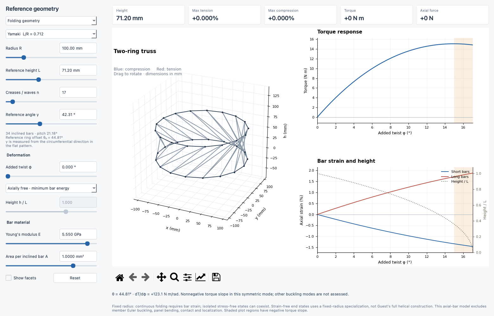
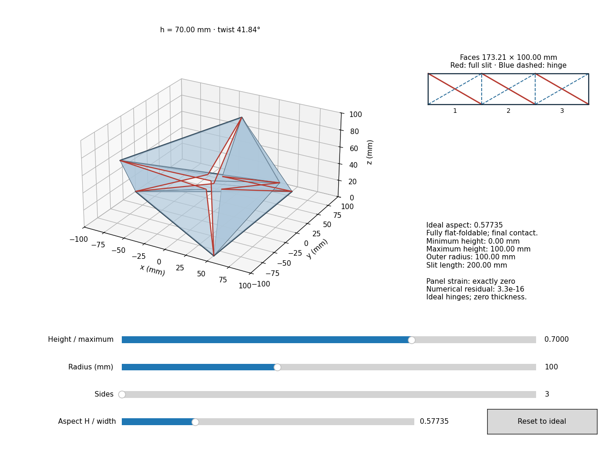
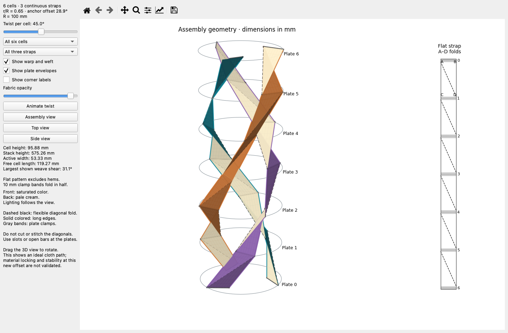
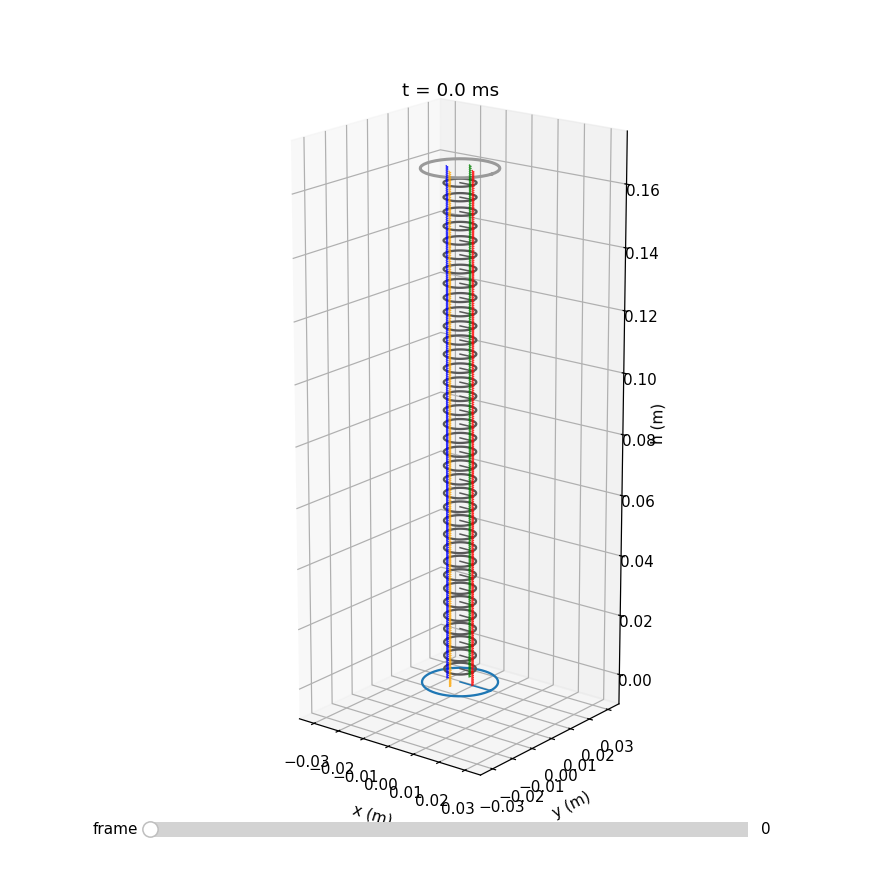
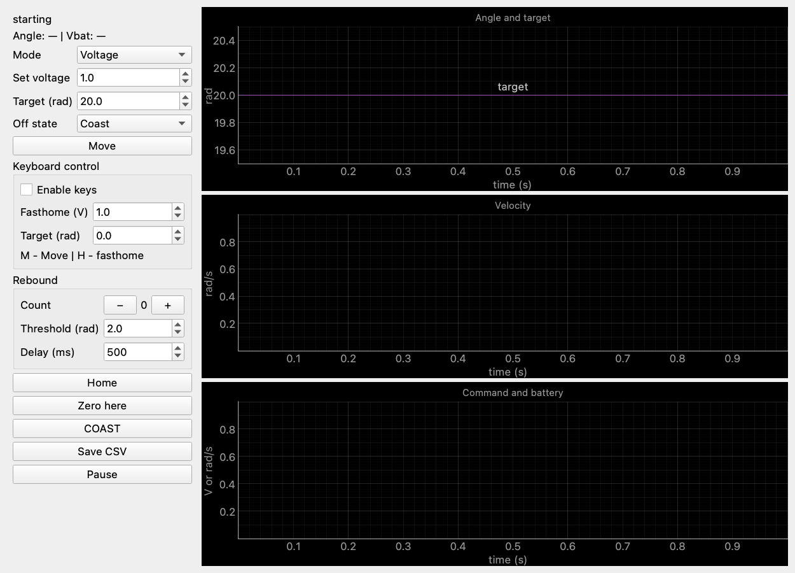
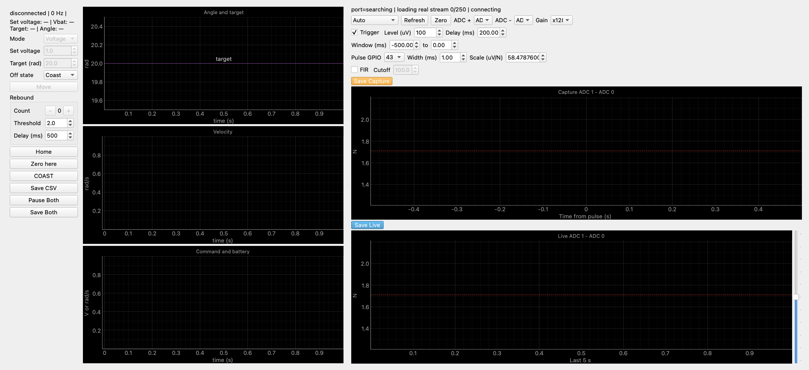
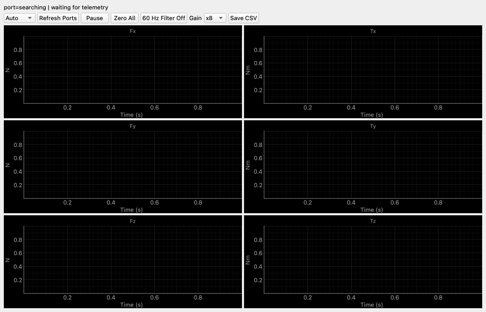
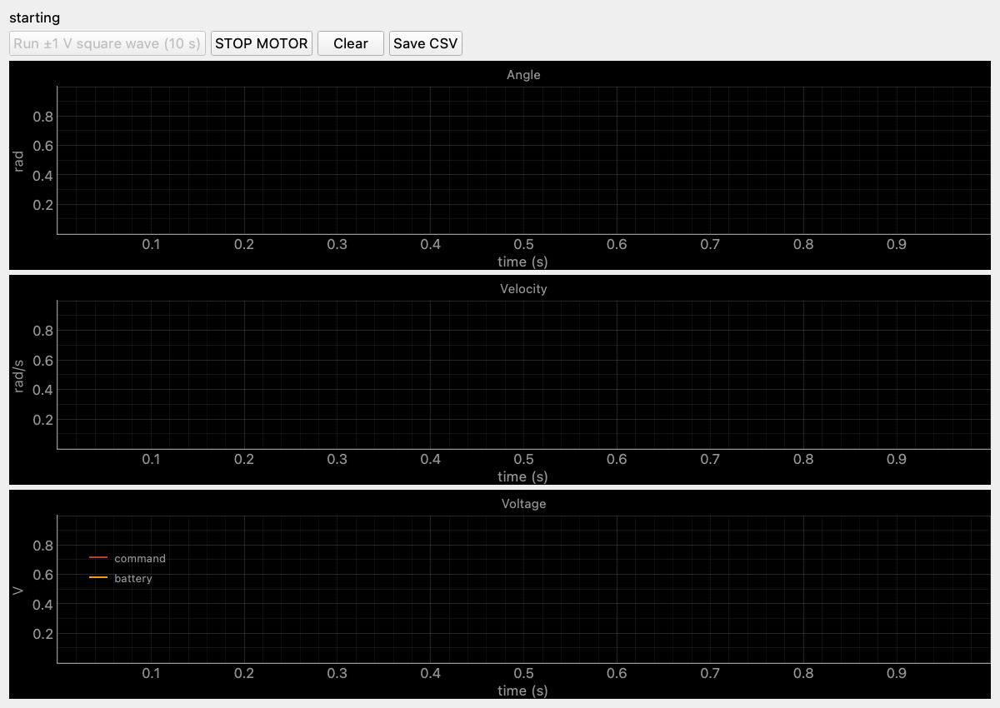

# DNA jumper

## GUI launch commands

Run these commands from the repository root. Click a screenshot to view it at full size.
Hardware screenshots show disconnected interfaces.

| GUI | Command | Screenshot |
| --- | --- | --- |
| Hunt truss buckling | `python3 -m trussbuckling` |  |
| Rigid folding prism and aspect ratio | `python3 -m trussbuckling.research.rigid_demo --sides 3` |  |
| Tensile-cord cells and stacks | `python3 -m trussbuckling.cable_gui` |  |
| Six-cell fabric assembly | `python3 -m trussbuckling.fabric_gui` |  |
| Three fabric strips without weave shear | `python3 -m trussbuckling.research.no_shear.gui` |  |
| Spring-chain interactive 3D simulation | `python3 new_modeling/springchain.py --show` |  |
| DNA Jumper motor control | `python3 motor_gui_v2.py` |  |
| Motor control + minDAQ | `python3 motor_mindaq_gui.py` |  |
| Live force/torque | `python3 ft_live_gui.py` |  |
| BLE stream test plots | `python3 ble_stream_plot.py` |  |

The rigid prism also accepts `--radius 100 --sides 6 --aspect 1`.
The force/torque GUI accepts `--port /dev/cu.…`; run one application per serial port.
The combined motor/minDAQ GUI requires the external `mindaq_fw` checkout at the path configured in `motor_mindaq_gui.py`.
All GUIs use PyQt6. Install their dependencies with `python3 -m pip install -r requirements.txt`.
Scripts can also be launched by absolute path, for example `python3 /Users/chris/Code/dnajumper/motor_gui_v2.py`.

[Radius selection studies](studies/radius_selection/README.md) contains the current experiment sources, selected figures, numerical evidence, and reproduction instructions from the length sweep and radius separation chats.

Other modeling and measured-data analysis remain in [new_modeling](new_modeling/); firmware is in [gordonjumper](gordonjumper/).
