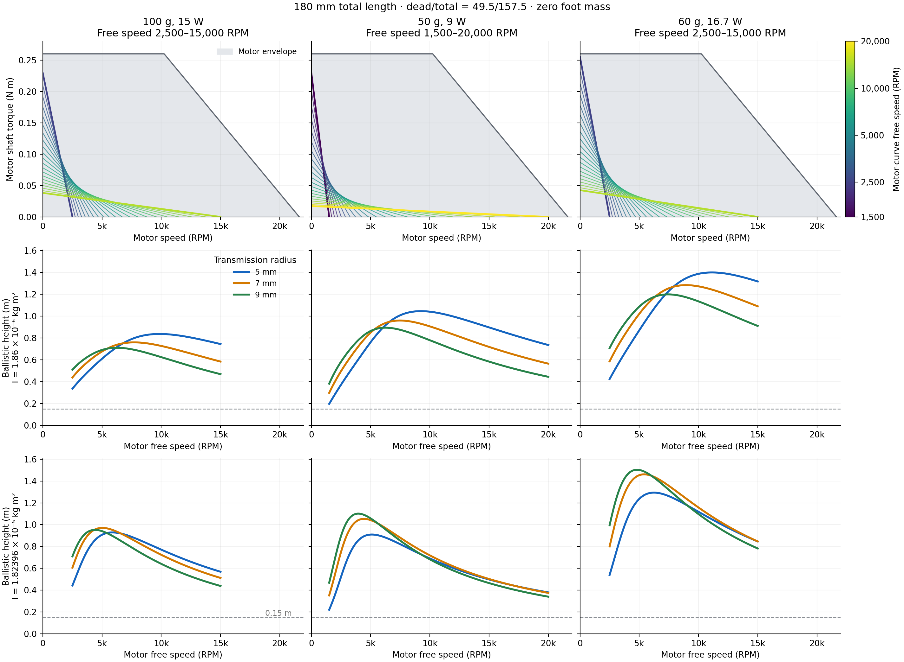
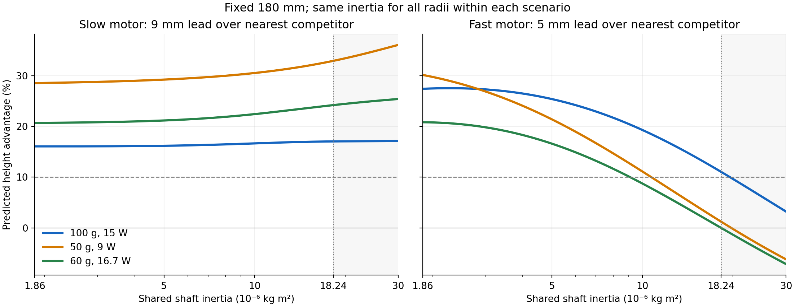

# Equal power motor study

At fixed 180 mm length, a slower motor with more torque favors 9 mm, while a faster motor with less torque favors 5 mm, even at the same peak shaft power. Each motor curve is linear, with stall torque = 4 × peak power / free angular speed.

The latest baseline is **100 g, 15 W, 2500–15000 rpm**. With the same constant shaft inertia assigned to all radii, its fast-end 5 mm advantage remains about 11.1% at I = 1.82396e-5 kg m². It drops below 10% near I = 1.95e-5 kg m². Radius-dependent or changing transmission inertia needs further modeling.





The 50 g / 9 W option gives stronger separation at the bare-rotor inertia, but its fast-end margin falls to about 1.2% at the higher inertia. The 60 g / 16.7 W option nearly loses that reversal. These alternatives remain in the figures because they explain the inertia tradeoff.

## Source and reproduction

Run from this folder with Python 3.11:

```sh
MPLBACKEND=Agg python3.11 plot_motor_height.py
MPLBACKEND=Agg python3.11 inertia_sensitivity.py
```

[model.py](model.py) holds the dynamics, experiment settings, envelope, and independent time-domain checks. The plot scripts regenerate the latest PNG, SVG, CSV, and JSON evidence in [results](results/). Checks cover stroke completion, motor envelope, numerical convergence, and energy balance.

## Optimization evidence

[results/optimization](results/optimization/) retains the numerical search and grid supporting the 50 g alternative, conditional on bare-rotor inertia. Its plot's earlier “recommended” label applies to that nominal-inertia optimization; the sensitivity evidence above supports the current baseline.

- [optimize.py](optimize.py) searches mass, power, and speed endpoints; [optimize_practical.py](optimize_practical.py) applies practical height and torque limits.
- [optimum.py](optimum.py) refines and verifies the optimum and regenerates the grid. It is a longer calculation.
- [Optimum results](results/optimization/optimum_results.json) include independent solver and sensitivity checks. [Fixed speed results](results/optimization/fixed_speed_optimum.json) record the separate 2500–15000 rpm comparison.

For a bench test, calibrate the target motor lines, keep total moving mass and geometry fixed across radii, and measure takeoff velocity. Use repeated trials in randomized radius order; calculate body energy as ½mv² and height above takeoff as v²/(2g). Keep string condition, initial twist, and motor temperature consistent.
