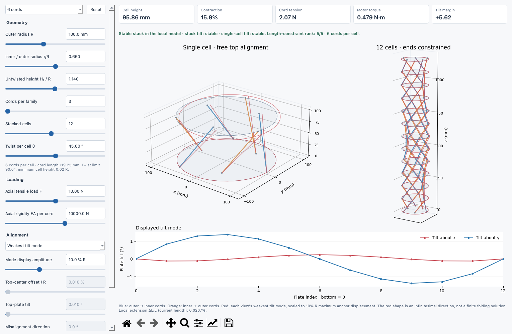

# Hunt truss buckling

Interactive Python reconstruction of the two-ring triangulated truss in Hunt and
Ario, *Twist buckling and the foldable cylinder* (2005), Section 6 and Fig. 10.
The source PDFs are in [papers](papers/).

For the subsequently verified **exact rigid-folding prism with diagonal slits**,
constant outer radius and zero panel strain throughout motion, see the
[research derivation and viewer](research/README.md). It has different cut and
hinge topology from the elastic Hunt model below.

## Tensile-cord alignment GUI

The separate viewer for the two-radius cord design starts with **six cords**,
one cell and a **12-cell stack**:



```sh
python3.11 -m trussbuckling.cable_gui
```

Sliders control outer radius, inner/outer radius ratio, untwisted height/radius,
cord count, cell count, twist, axial load and cord axial rigidity `EA`. Twist
limits update before the first cord crossing or zero cell height. The numeric
values beside sliders are editable. Drag either 3D view to change its camera.

- **Weakest tilt mode** overlays an exaggerated linear mode on each assembly.
  Its scale is a percentage of outer radius; it is not a finite folding solution.
- **End misalignment** solves the linear response to a prescribed top-center
  offset and top-plate tilt. The drawing uses the input scale without visual
  amplification. Slack-cord and large-response warnings mark invalid predictions.
- The **Equal radii (weak)** preset demonstrates the original alignment problem.
  Six- and eight-cord presets restore the two-radius construction.

The model uses exact ideal geometry and a local, prestressed elastic stiffness
matrix. It does not follow the nonlinear deformation of one fixed-natural-length
elastic cord through the entire folding path. The reported extension `ΔL/L`
uses current geometric length. The code and units are documented directly in
[cable_model.py](cable_model.py); the GUI is in [cable_gui.py](cable_gui.py).
See the [alignment derivation](research/README.md#alignment-stability-with-fabric-sides)
for the assumptions and stability calculation.

```sh
python3.11 -m unittest trussbuckling.test_cable trussbuckling.test_cable_gui
```

## One-piece fabric cutting templates

The default cutting package uses **one fabric blank for the entire twelve-cell
stack**, plus thirteen copies of one plate. The six fingers join through slack
handling carriers only at the base. There are no separate cords, sewn joins,
or individual fasteners. Each finger is fixed at every plate using the marked
bonding lands; the slots alone do not hold its effective length.

Generate the SVG/DXF cutting files, full-size PDFs, A4 tiles, assembly guide and
ZIP package from the repository root:

```sh
python3.11 -m pip install -r trussbuckling/requirements-templates.txt
python3.11 -m trussbuckling.make_templates
```

The default dimensions are:

| Item | Dimension |
|---|---:|
| Outer attachment radius R / inner r | 100 / 65 mm |
| Fabric blank | 124 x 1756.223 mm, one connected part |
| Free leg length | 119.268604 mm, 72 spans |
| Free rail / grip width | 6 / 14 mm |
| Grip allowance | 20 mm, 78 grips |
| Plate outside diameter | **230 mm** including slot margin |
| Nominal plate / fabric thickness | 3 / 0.25 mm |

The 100 mm attachment radius is not the plate's outside radius: the extra
15 mm retains material around the outer slots. Both free-span gauge lines of
each grip register to its root on opposite plate faces. The nominal route is
8 mm out, 3 mm through the slot, and 8 mm back, with 1 mm left for folding.
Align the gauge marks rather than assuming the slot fixes the length.

Print **100% / actual size** and measure the 100 mm calibration bars. Black is
through-cut; blue and gray are transfer marks. The DXFs contain separate CUT
and MARK layers. The marked SVGs include lane and plate-root labels; cut-only
SVGs omit all marks. All thirteen plates use the same cutting profile, with
clockwise reference indexing defined in the assembly guide.
`plate_back_marked.svg` mirrors the gauge positions for marking the rear face
after a left-to-right flip; assembly clocking always refers to the front face.

The bonded grip is an untested prototype, with no material/adhesive load rating.
Check one routed grip at the intended tension before making the whole stack.
The point-link geometry is verified; finite fabric width, plate bending,
adhesive peel and durability still need physical testing.

Files appear in `trussbuckling/templates/default`, `output/pdf`, and
`output/strap_templates.zip`. The ZIP includes the generator source. Change
radius, ratio, cells, or material thickness using the generator's `--help`.

```sh
python3.11 -m unittest trussbuckling.test_templates
```

## Hunt viewer

From the repository root:

```sh
python3.11 -m pip install -r trussbuckling/requirements.txt
python3.11 -m trussbuckling
```

Drag the 3D view to rotate it. Each slider also has an editable numeric value.
Choose a Yamaki length and reference construction to compare Fig. 10's initial
buckling and folding geometries. These are different **reference crease patterns**,
not two deformation states of the same stress-free truss.

The controls cover radius, reference height, number of waves, reference crease
angle, added twist, Young's modulus, bar area, and prescribed height. Axially free
mode chooses the height that minimizes bar energy. The height control becomes
active in prescribed-height mode. Changing the crease angle selects Custom.

Choose **Strain-free end states** to design a reference pattern with zero bar
strain both at the reference height and when flat. This mode derives the angle
from R, L and n. **Choose n automatically** chooses the smallest count that
meets the requested peak strain during axially free folding. Turn it off to
choose n yourself. The designer reports bar lengths, flat twist and peak strain.
The strain allowance is a design target, not a material property.

## What is reproduced

Two rigid, coaxial, circular end polygons of radius R, each with n vertices;
n short inclined bars and n long inclined bars; pin joints; equal E and A for
both inclined families. The rings may rotate relative to each other and change
their separation. The rim edges remain fixed by the ring constraint.

Hunt supplies the developed crease geometry and Table 3 reference angles and
wave counts, but omits the truss member areas, constitutive law and complete
boundary/solver specification. Here those choices are explicit: stress-free
spatial reference bars, linear elastic axial forces, and either zero axial load
or prescribed height. E defaults to Yamaki's 5.55 GPa; A = 1 mm² is an illustrative
truss area, not a calibrated equivalent of the shell. **Absolute Fig. 11 torques
are not reproduced.** The Simple/Clamped selectors use the paper's rounded
initial-mode angles, not shell boundary-condition calculations.

Facets are only a visual guide. The calculation includes no panel bending,
crease springs, member Euler buckling, contact, plasticity, ring tilt or
nonuniform/localized modes. Large strains are mathematical extrapolations of
the chosen elastic law. Two percent is a notice threshold, not a material limit.

## Geometry, derived

All calculations use mm, N, MPa and radians. Torque and energy are N mm;
the GUI displays torque in N m. Positive torque is the external holding torque
dU/dφ; the restoring torque is its negative. Axial force is the external holding
force dU/dh, positive in tension.

### 1. Hunt's developed-sheet angles

Let L be reference height, R radius, and n the number of circumferential waves
(there are 2n inclined bars). Define α = π/n and **arc** pitch c = 2πR/n.
In Fig. 3, γ is measured from the circumferential direction, and β = γ − α.
Hunt's Eqs. (1-2) give

```text
sin(γ) sin(γ − α) = (L/c) sin(α)
cos(2γ − α) = cos(α) − 2(L/c) sin(α)
γ = [α + acos(cos(α) − 2(L/c) sin(α))] / 2
β = γ − α
```

The non-overhanging branch γ ≤ 90° requires 0 < L ≤ c cot(α).
This sets the dynamic length-slider ceiling, approximately 2R. n ranges from
3 to 64 (a practical display cap); the gamma slider prevents a reference bar
wrapping beyond a half-turn.
Radius spans 10–500 mm. E and A use logarithmic sliders because they multiply
all forces without changing the axially free geometry.

Table 3 folding references, at R = 100 mm:

| L (mm) | n | γ, rounded | β, rounded |
| ---: | ---: | ---: | ---: |
| 22.9 | 23 | 24° | 16° |
| 35.9 | 21 | 30° | 21° |
| 51.0 | 19 | 35° | 26° |
| 71.2 | 17 | 42° | 32° |
| 113.8 | 14 | 56° | 43° |
| 160.8 | 12 | 72° | 57° |

The experimental 500-4 preset uses the first of the paper's two observations,
γ = 73°. The paper's prose about an increase in γ at Fig. 10 conflicts with
Table 3; the program follows the table and Fig. 3's angle convention.

### 2. Embed the reference pattern and move the rings

Our explicit embedding maps the developed circumferential run L cot(γ) onto
the cylinder as an arc. With δ = 2π/n, reference ring rotation θ₀, and user-added
twist φ,

```text
θ₀ = L / (R tan(γ))
θ = θ₀ + φ
bottom vertex i = (R cos(iδ),     R sin(iδ),     0)
top vertex i    = (R cos(iδ + θ), R sin(iδ + θ), h)
short bar: bottom i -> top i
long bar:  bottom i -> top (i+1 modulo n)
a² = h² + 4R² sin²(θ/2)
b² = h² + 4R² sin²((θ+δ)/2)
```

These spatial bar lengths are exact for these vertices. Their rest lengths
a₀, b₀ are evaluated at h = L, φ = 0. They differ from the developed-sheet
fold lengths: the embedding and stress-free reference are modeling assumptions.
Do not substitute the spatial rim chord 2R sin(π/n) for c in Hunt's equation.

### 3. Why continuous folding requires strain

Subtracting the exact length equations gives

```text
b² − a² = 4R² sin(α) sin(θ+α).
```

If both a and b are fixed, sin(θ+α) is fixed, so θ has isolated solutions.
The other solution sharing both rest lengths is

```text
θ₂ = π − 2α − θ₀
h₂² = L² − 4R² cos(α) cos(θ₀+α).
```

It exists only if h₂² ≥ 0. Even two stress-free endpoints do not give a
continuous strain-free path. The length Jacobian determinant is
2hR² sin(α) cos(θ+α)/(ab); it vanishes at infinitesimal singularities, which
also do not establish a finite rigid folding path.

Hunt explicitly reports stretching/compression, especially for longer shells,
and suggests localization to a shorter buckle length. For the default 71.2 mm,
n = 17 folding geometry, this reconstruction reaches approximately 1.88%
maximum bar strain by its first axially free flat state, at φ ≈ 17.04°.
The paper's low-energy mechanism must not be interpreted as exactly zero strain
under these fixed-ring constraints. Guest and Pellegrino make the same
small-strain distinction in
[The Folding of Triangulated Cylinders, Part I](https://www.its.caltech.edu/~sslab/PUBLICATIONS/Folding%20Triangulated%20CylindersI.pdf),
cited by Hunt.

### 4. Design two stress-free end states

Guest and Pellegrino's
[Part I: Geometric Considerations](https://faculty.washington.edu/moishe/branko/Uniform%20polyhedrals/Guest.1.pdf)
designs cylinders with unstrained deployed and packaged states, while allowing
small strains between them. Their general helical cylinders change radius as
they fold. The following is a derived specialization for this program's two
fixed-radius rings; it does not implement the full helical construction. Their
helix-start count n is not automatically the same as this program's ring count.

Set h₂ = 0 in the second equal-length configuration from the preceding section.
This gives an exact spatial endpoint condition:

```text
L² = 4R² cos(α) cos(θ₀+α),       α = π/n
q = L² / [4R² cos(α)]
θ₀ = acos(q) − α = π/2 − α − asin(q)
γ = atan2(L, Rθ₀)
φflat = π − 2α − 2θ₀ = 2 asin(q)
```

The chosen nonnegative-rotation branch requires 0 < L ≤ 2R cos(π/n).
The calculated γ uses this GUI's developed-run convention; it is not a helix
angle from Guest and Pellegrino. Spatial rest lengths come directly from the
vertex distances as before. The rim chord is c = 2R sin(π/n).

Radius and reference length alone leave n undetermined. The designer optionally
adds a practical criterion: choose the smallest feasible integer n whose peak
bar strain is no greater than the user's allowance. It checks n = 3…256 directly.
This cap keeps the interactive mesh manageable. A target that cannot be met
produces an explicit message with the best achievable strain, rather than
silently choosing an unsuitable design. Auto mode permits lengths up to the
geometric bound for n = 256; manual mode uses the selected n's bound.

The peak strain calculation is analytical in twist. Along the free-height branch,

```text
1/a + 1/b = constant
D = b² − a² = 4R² sin(α) sin(θ+α)
```

D is maximal at θ = π/2 − α, halfway between the designed endpoint rotations.
Increasing D at fixed reciprocal sum decreases a and increases b. Therefore
both strain magnitudes attain their maximum at φ = φflat/2. One call to
`state()` at that twist gives the exact peak for this model; no angular sampling
or numerical optimization is needed to size n. E and A do not affect this choice
because they scale both bar families equally.

At R = 100 mm, L = 71.2 mm:

| Construction | n | γ | Added flat twist | Peak strain during folding |
| --- | ---: | ---: | ---: | ---: |
| Hunt folding geometry | 17 | 42.313° | 17.043° | 1.880% |
| Stress-free endpoints, manual n | 17 | 29.534° | 14.816° | 0.07267% |
| Stress-free endpoints, 0.1% allowance | 13 | 30.719° | 15.000° | 0.09837% |

The new endpoint patterns have zero strain at both ends. They still store
elastic energy between those ends: the midpoint is an energy maximum with zero
torque and negative torsional stiffness. Small folding strain does not remove
the torque-controlled snap-through barrier. A prescribed-height path generally
has different strains; the designer's target applies only to axially free motion.

## Energy, forces and stability

For each family let ℓ be its current length and ℓ₀ its rest length. Engineering
strain is ε = (ℓ−ℓ₀)/ℓ₀ and member axial force is EAε. Summing n bars per family,

```text
U = (nEA/2) [(a−a₀)²/a₀ + (b−b₀)²/b₀]
```

For ψ = θ or θ+δ, the length derivatives are analytical:

```text
ℓ_h  = h/ℓ
ℓ_θ  = R² sin(ψ)/ℓ
ℓ_hh = (ℓ²−h²)/ℓ³
ℓ_hθ = −h R² sin(ψ)/ℓ³
ℓ_θθ = R² cos(ψ)/ℓ − R⁴ sin²(ψ)/ℓ³
U_i  = Σ [nEA/ℓ₀] (ℓ−ℓ₀) ℓ_i
U_ij = Σ [nEA/ℓ₀] [ℓ_i ℓ_j + (ℓ−ℓ₀) ℓ_ij]
```

The sums have just two terms. Torque M = U_θ and axial force F = U_h.
For h > 0, axially free equilibrium F = 0 reduces to

```text
1/a + 1/b = 1/a₀ + 1/b₀.
```

The left side strictly decreases with h. If its value at h = 0 is already
below the right side, h = 0 is the constrained energy minimum. Otherwise one
bracketed scalar root gives the unique positive minimum. The bracket
[0, max(a₀,b₀)] always contains it. No numerical optimization or continuation
history is needed. The first flat twist uses the same monotone equation with
h = 0. The free-mode slider stops at first collapse, or at the end of the selected
non-wrapping twist branch if collapse is unavailable. Geometry beyond contact
is not physical.

With height prescribed, torsional stiffness K = U_θθ. With height relaxed,

```text
K = U_θθ − U_hθ²/U_hh
  = U_θθ − nEA R⁴ [Σ sin(ψ)/ℓ³]² / [Σ 1/ℓ³]    (h > 0, F = 0).
```

The second expression avoids dividing two vanishing quantities near h = 0.
Negative K marks a local **torque-control instability of this symmetric branch**.
With twist held, free-height equilibria minimize axial energy. With height held,
K describes only the torsional degree of freedom. Positive K does not certify
unmodeled buckling modes; the flat boundary needs contact physics.

## Code and verification

- [model.py](model.py): geometry, energy, derivatives and the scalar height solve;
  no GUI dependency. `state(p, twist, height=None)` uses added twist in radians.
- [gui.py](gui.py): native Qt controls and Matplotlib rendering.
- [test_model.py](test_model.py): source-angle checks, closed mesh, independent
  finite differences of energy and forces, energy minima, scaling, and a
  bistable example with strain-free endpoints and strained intermediate states.
- [test_design.py](test_design.py): endpoint geometry, analytical strain maxima,
  automatic crease sizing and impossible-target checks.

```sh
python3.11 -m unittest discover -s trussbuckling -p 'test_*.py'
```
