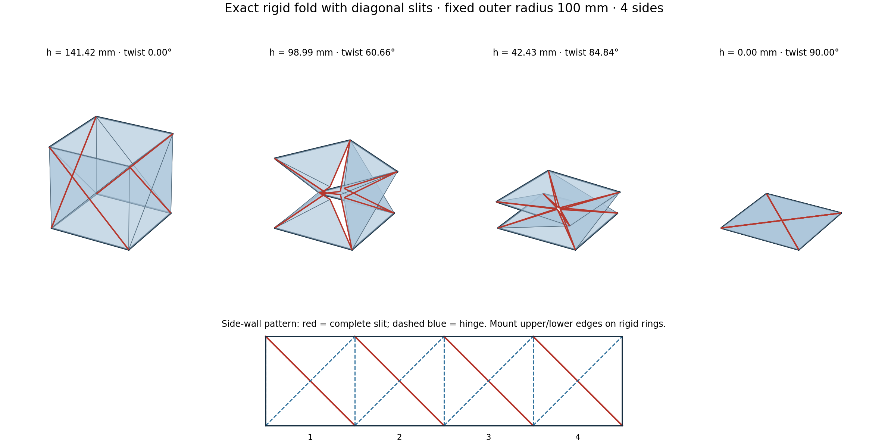
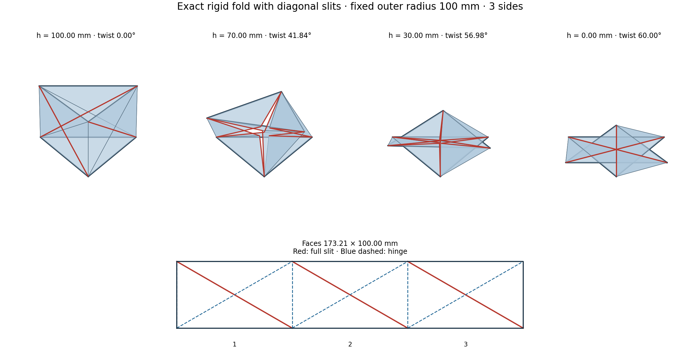
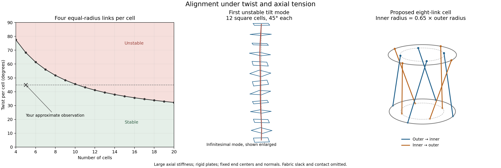
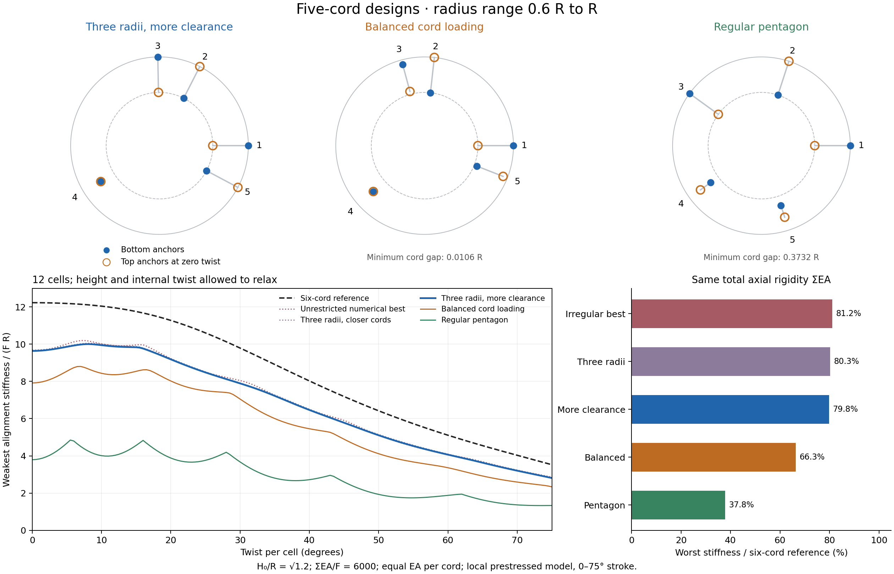
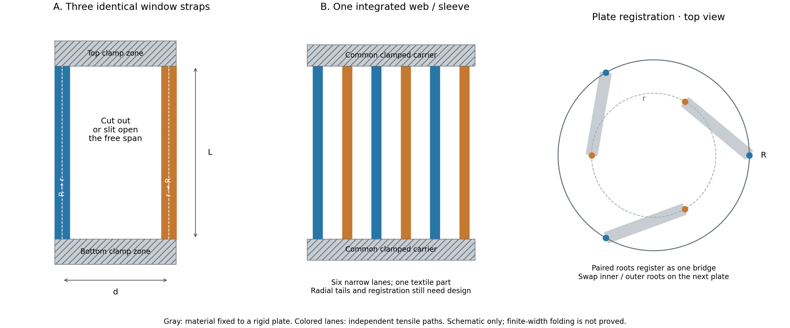

# Exact strain-free folding at fixed outer radius

The accepted use of narrow slits makes the requested mechanism possible.
This is a verified reconstruction of published FP-ori, not a claim of a new
crease family. The independent work here supplies explicit general-n
coordinates, edge-length identities, an outer-envelope proof, and checks.



Run the standalone research viewer from the repository root:

```sh
python3.11 -m trussbuckling.research.rigid_demo
```

The height slider follows the exact geometric path; no elastic relaxation or
numerical constraint solver is used. The radius and side count (3–24) are adjustable.
This research viewer is separate from the earlier elastic Hunt GUI.

The **Aspect H / width** slider changes the initial face height divided by
its width, from 0.1 to 2. **Reset to ideal** sets `1/sqrt(3)` for n=3 and
`1` for n>=4, using full precision. Changing the side count retains the selected
ratio; the button always uses the current side count. An initial custom value
can be supplied with `--aspect`, for example `--sides 3 --aspect 1`.

Changing aspect changes the crease pattern, not its strain during folding.
The height slider's lower bound updates to the selected pattern's geometric
limit. Tall faces stop when side panels meet. Short faces stop when panels
reach the end planes: solid caps would contact there, while open rings may
allow further motion outside the displayed axial envelope. Only the ideal
ratio reaches an entirely flat stack on the collision-free branch. The viewer
shows the minimum height and limiting event.

- [rigid_prism.py](rigid_prism.py): compact exact mathematical model.
- [rigid_demo.py](rigid_demo.py): viewer and snapshot generator.
- [crease_pattern.svg](crease_pattern.svg): schematic unfolded wall pattern.
- [square noncollision proof](square_proof.txt): continuous proof for n=4.

## Triangular case: rectangular faces, n=3

**A triangular cell folds completely flat when its original height is R and
its side width is sqrt(3) R.** The previously tested square-face triangular
cell had height sqrt(3) R and collided before flattening. Changing the aspect
ratio removes that collision; no extra cuts are needed.



```sh
python3.11 -m trussbuckling.research.rigid_demo --sides 3
```

Use three rectangular faces, each width `sqrt(3) R` and height `R`. On every
face cut the full descending diagonal and hinge the ascending diagonal, as
drawn. The slit length is `2R`; both diagonals make 30 degrees with the rim.
Retain the three vertical corner hinges and hinge the upper/lower edges to
rigid triangular rings. Each slit splits the center into two distinct material
points; do not leave a connecting bridge there. The SVG is a dimensioned
schematic, not a manufacturing file with thickness/kerf allowances.

For `R=100 mm`, each face is `173.205 × 100 mm`, with a `200 mm` slit.
The maximum cell height is `100 mm`. A reference height of `71.2 mm` is simply
the partially folded state `h/R=0.712`. For a larger reference length, stack
cells; alternating their handedness cancels total twist. The viewer draws one
cell and automatically selects this rectangular pattern when n=3.

The exact height–twist law is

\[
h=R\sqrt{2\cos\theta-1},\qquad 0\le\theta\le\pi/3.
\]

For a simple explicit implementation, set `f=h/R`, then calculate

\[
\theta=2\arcsin\!\left(\frac{\sqrt{1-f^2}}2\right),\quad
w=\sqrt{1-\cos\theta+\sqrt3\sin\theta},\quad t=\frac{f}{1+w},
\]
\[
q=\frac{1-t^2}{1+t^2},\qquad p=\frac{2t}{1+t^2}.
\]

With `a=R/2`, `b=sqrt(3)R/2`, `delta=2pi/3`, and `Q` denoting rotation
about the axis, the four vertex groups are

\[
\begin{aligned}
B_k&=Q(k\delta)(a,-b,0),\\
T_k&=Q(k\delta+\theta)(a,-b,0)+(0,0,h),\\
J_k&=Q(k\delta)(a(1-q),0,ap),\\
I_k&=Q(k\delta+\theta)(a(1-q),0,0)+(0,0,h-ap).
\end{aligned}
\]

Use the same four triangle indices per face listed in the Geometry section
below. The two rim triangles have side lengths `R,R,sqrt(3)R`; the two other
triangles are equilateral with side `R`. These lengths remain exact throughout
the motion. Ring vertices remain at radius R, and the interior tips have radius
`a(1-q)` between 0 and R/2. Convexity of the disk therefore bounds every point
of every panel by R. Also `0<ap<h/2` throughout the open interval, keeping all
panels strictly between the caps except at their attachments.

The [continuous proof](triangle_proof.txt) establishes panel rigidity and
separates every possible pair of triangles by angular sectors, height, or
explicit planes with strictly positive signed distances. The six slit tips
reach the axis only at `h=0`, when the two end triangles differ in orientation
by 60 degrees. Their final footprint is a six-pointed star inside the original
circular envelope. The envelope stays fixed; the initial triangular footprint
does not. There are no crossings for `0<h<R`; the final zero-thickness stack
has intentional contact and overlap. Real thickness requires hinge offsets
and a positive final stack height. This is a kinematic model; guides or
actuation select the coaxial folding branch, and stability depends on hinge
stiffness and applied loads.

This uses the published FP-ori topology at its triangular parameter
`alpha=beta/2=30 degrees`. Liu et al.'s Eq. (14) includes that value, and the
paper points to triangular flat configurations in Supplement §1. The explicit
motion and collision certificate here were derived independently. This is
not a novelty claim; the supplement itself was not available for inspection.

Verification: 46 project tests pass. An independent implementation solves
the original hinge equation rather than reusing the formula above. It checked
1,201 configurations including both rigid caps, finding maximum relative edge
error `6.67e-16`, fixed outer radius to floating-point precision, and no interior
crossings or coplanar overlaps. Six near-contact numerical flags were rejected
at 80-digit precision. See [audit](verification/triangle.py),
[recorded results](verification/triangle.json), and
[symbolic checks](verify_triangle.py). Run:

```sh
python3.11 trussbuckling/research/verify_triangle.py
python3.11 -m trussbuckling.research.verification.triangle
```

## Arbitrary face aspect: explicit calculations

Let `B=H0/width` be the aspect slider value, `alpha=pi/n`,
`a=R cos(alpha)`, `b=R sin(alpha)`, and `c=B*b=H0/2`.
The ring constraint gives `h^2=4c^2-4R^2 sin(theta/2)^2`. To calculate the
slit tips without solving a numerical constraint, set

```text
X = a*(cos(theta)-1) + b*sin(theta)
Y = a*sin(theta) + b*(1-cos(theta))
D = 2*c - b*Y/c
t = (D+X) / (h + sqrt(h*h + X*X - D*D))
q = (1-t*t)/(1+t*t)
p = 2*t/(1+t*t)
```

The equation `h*p-X*q=D` preserves the remaining triangle edge, while
`p*p+q*q=1` preserves the two rim-to-tip distances. Replace the tip radial
coordinate by `a-c*q` and its lower height by `c*p` in the formulas above.
Rim-based triangles have sides `2b,sqrt(b*b+c*c),sqrt(b*b+c*c)`; the other
triangles have sides `2c,sqrt(b*b+c*c),sqrt(b*b+c*c)`. The implementation uses
the separately simplified ideal formulas near their flat endpoints to avoid
an indeterminate `0/0` in this general expression.

The ideal aspect is `B0=min(1,cot(alpha))`. For `B>B0`, the contact height
fraction is exactly `sqrt(B*B-B0*B0)/B`. The contact twist is 60 degrees
for n=3, and `2pi/n` for n>=4. In particular, n=3 with aspect 1 reproduces
the earlier square-face collision at `h/H0=sqrt(2/3)`.

For `B<B0`, the end-plane boundary is `p=0,q=1`. Write `A=cot(alpha)`.
The positive root of `B^2+(B-A)u+(B^2-A*B-1)u^2=0` gives

```text
u = 2*B*B / (A-B + sqrt((A-B)**2 + 4*B*B*(1+A*B-B*B)))
theta_limit = 2*atan(u)
minimum_fraction = sqrt(1 - (sqrt(A*A+1)*u/(B*sqrt(1+u*u)))**2)
```

These contact equations are analytical. The continuous nonintersection
proofs in this directory cover the ideal ratios. For varied ratios, an
independent collision audit checked 42 combinations of side count and aspect,
84 interior twist samples each, including caps; no crossings remained after
resolving near-contact numerical flags with 80-digit arithmetic. Geometry
checks of 4,848 states also preserved all edge lengths and both envelopes
(maximum relative edge error `7.11e-15`). Regression tests cover arbitrary
rectangles, the contact geometry, and rejecting heights below each limit.

## Square-face family: dimensions and practical meaning (n>=4)

Each original side wall is a square of side `l = 2R sin(pi/n)`. At its fully
extended prism state the cell height is `l`. Every triangle has side lengths
`l, l/sqrt(2), l/sqrt(2)`. End polygons keep their shape and radius, while
interior hinges move inward and the slit lips separate. Maximum outer radius
is constant; the tube is polygonal and its sidewall opens into gaps.

For R=100 mm, a four-sided cell has l=141.421 mm. A 71.2 mm reference height
is obtained simply by starting partway folded; further motion still reaches
zero height exactly. Cells can be stacked to obtain larger heights. With m
identical cells, any reference length in `(0, m*l]` is attainable. Alternating
handedness in successive cells cancels net end rotation; same handedness adds
it. The symmetric motion assumes coaxial parallel end rings or a suitable guide.

Narrow means small slit WIDTH: each slit has the full diagonal LENGTH
`sqrt(2)*l` and reaches both corners. A remaining bridge would impose a new
constraint. The design is geometrically strain-free in its panels, not
necessarily zero energy: real hinges bend and have stiffness/friction. Finite
panel thickness requires hinge clearance and a nonzero final stack height.

## Verification status

The analytical identities below hold for the full interval and all integers
n>=4. An independent numeric sweep of 8,008 configurations (n=4,5,6,8,12,17,32,64;
1,001 heights each) gave maximum relative triangle-edge error 1.37e-14, with
no violation of the fixed radial envelope. Such residuals are floating-point
roundoff, not modeled material strain.

The whole n>=4 family has an analytic nonintersection proof below, checked by
[verify_separation.py](verify_separation.py). The square case has an additional
independent proof and [symbolic panel checks](verify_square.py). A separate
1,001-height collision sweep, including rigid caps, found no transverse
intersections; near-contact numerical flags were resolved at 80-digit precision.
The intentionally laminated flat endpoint has panel contact. A further 3,224-state independent general-n audit found no transverse
intersections or positive-area coplanar overlaps; see [results](verification/general.json).
The continuous nonintersection claim rests on the proof, not this sampling.

For the earlier R=100 mm, L=71.2 mm, n=17 example, use two cells:
each square side is 36.7499 mm and each full diagonal slit is 51.9722 mm.
Start at 5.22785 degrees twist per cell and fold to 21.17647 degrees per cell.
Every panel remains congruent throughout. The viewer displays one cell;
stacking and alternating chirality are geometric design rules, not extra viewer controls.

Exact symbolic checks require SymPy; numerical collision diagnostics also use
mpmath for ambiguous near-contact cases. The viewer itself uses only the existing
NumPy/Matplotlib environment. Reproduce the checks with:

```sh
python3.11 -m unittest discover -s trussbuckling -p 'test_*.py'
python3.11 trussbuckling/research/verify_square.py
python3.11 trussbuckling/research/verify_separation.py
python3.11 -m trussbuckling.research.verification.square
python3.11 -m trussbuckling.research.verification.sweep
```

## Detailed derivation

Independent derivation of the collision-free branch proposed in Liu et al.,
[Rigid-foldable cylindrical origami with tunable mechanical behaviors](https://doi.org/10.1038/s41598-023-50353-4),
Scientific Reports 14, 145 (2024). The paper supplies the design and reports
rigid flat folding for its 45-degree choice. The formulas and bounds below
are derived here; the bounds do not depend on a numerical continuation solver.

## Geometry

Let `n >= 4` be an integer, `l > 0` the regular polygon side length, and set

\[
\gamma=\pi/n,\quad\delta=2\gamma,\quad b=l/2,\quad
A=\cot\gamma,\quad a=bA,\quad R=\sqrt{a^2+b^2}.
\]

Here `a` is the apothem and `R` the circumradius. The initial prism height
is `l`. Let `Q(t)` denote rotation about the z-axis by angle `t`.
For `0 <= theta <= delta`, define

\[
u=\tan(\theta/2),\qquad
h=l\sqrt{\frac{1-A^2u^2}{1+u^2}}
 =l\sqrt{\frac{\cos\theta-\cos\delta}{1-\cos\delta}}.
\]

The interior folding angle can be evaluated without solving an implicit
equation. Write

\[
\tau=
\frac{\sqrt{1-Au}(1+u)}
{\sqrt{(1+Au)(1+u^2)}+\sqrt{2u(A+u)}},\qquad
q=\frac{1-\tau^2}{1+\tau^2},\qquad
p=\frac{2\tau}{1+\tau^2}.
\]

These are `q = cos(phi)` and `p = sin(phi)`, with `phi` decreasing from
`pi/2` to zero. Define four vertex families, each with `k=0,...,n-1`:

\[
\begin{aligned}
B_k&=Q(k\delta)(a,-b,0),\\
T_k&=Q(k\delta+\theta)(a,-b,0)+(0,0,h),\\
J_k&=Q(k\delta)(a-bq,0,bp),\\
I_k&=Q(k\delta+\theta)(a-bq,0,0)+(0,0,h-bp).
\end{aligned}
\]

With indices taken modulo `n`, the four side triangles in cell `k` are

```
(B_k, B_(k+1), J_k)
(B_k, T_k,     J_k)
(T_k, T_(k+1), I_k)
(B_(k+1), T_(k+1), I_k)
```

The two regular polygon ends may be rigid plates or rings. The formulation
prescribes coaxial parallel end polygons; guides or actuation must enforce
that motion if the physical linkage has additional nonsymmetric motions.

## Why every panel is exactly rigid

The rim edge length is `l`. The midpoint of `B_0 B_1` is `(a,0,0)` and
`q^2+p^2=1`; therefore

\[
|B_0J_0|^2=|B_1J_0|^2=2b^2=l^2/2.
\]

The connecting edge between corresponding ring vertices satisfies

\[
|B_0T_0|^2=h^2+4R^2\sin^2(\theta/2)=l^2.
\]

It remains to verify `|T_0 J_0|^2=2b^2`. Set

\[
X=a(\cos\theta-1)+b\sin\theta,\qquad
D=b(1+\cos\theta)-a\sin\theta.
\]

Expanding that squared-distance equation and canceling the height equation
gives the single condition

\[
hp-Xq=D.
\]

The half-angle identities give

\[
D=\frac{2b(1-Au)}{1+u^2},\quad X=uD.
\]

Substituting `p=2 tau/(1+tau^2)` and
`q=(1-tau^2)/(1+tau^2)` gives

\[
D(1-u)\tau^2-2h\tau+D(1+u)=0.
\]

The root continuous from `tau=1` at `theta=0`, and decreasing toward zero,
is

\[
\tau=\frac{D(1+u)}{h+\sqrt{h^2-D^2(1-u^2)}}.
\]

Using

\[
h^2-D^2(1-u^2)
=\frac{8b^2u(A+u)(1-Au)}{(1+u^2)^2}
\]

reduces it to the explicit expression above. All radicands are nonnegative
because `0 <= u <= 1/A` and `A >= 1`.

The isometry `(r,angle,z) -> (r,theta-angle,h-z)` exchanges the bottom and
top triangle pairs. Thus the same distances prove their rigidity too.
Every side triangle has side lengths `l, l/sqrt(2), l/sqrt(2)` throughout
the motion. This proves a finite, zero-strain path, rather than only an
infinitesimal mechanism or two matching endpoints.

## Fixed outer radius and axial bounds

For this branch, `0 <= q <= 1`. One way to check the sign is to put
`K=D/h`, where `0<K<=1` in the open interval. The equation
`p=K(1+u q)` and `p^2+q^2=1` has the nonnegative root

\[
q=\frac{-K^2u+\sqrt{1-K^2(1-u^2)}}{1+K^2u^2}.
\]

Its numerator is nonnegative because
`1-K^2(1-u^2)-K^4u^2=(1-K^2)(1+K^2u^2)>=0`.
Consequently

\[
0\le a-b\le |J_{k,xy}|=|I_{k,xy}|=a-bq\le a<R.
\]

Every ring vertex remains exactly at radius `R`. A disk is convex, so every
point of every triangular panel lies at radius at most `R`; the same holds
for the end polygons. The maximum radius is therefore exactly `R` at every
fold state. Interior slit-tip vertices move radially, and the wall is not
a smooth circular cylinder or a watertight surface.

For `0 < theta < delta`, the hinge equation gives

\[
\frac{bp}{h}=\frac{1+u q}{2(1+Au)}\le\frac12.
\]

Thus `0 <= z(J_k) <= h/2 <= z(I_k) <= h`; all panel points remain between
the end planes. This is actual axial collapse of the whole ideal mesh.

At `theta=0`, `h=l`, `p=1`, `q=0`, and `I_k=J_k`: the four triangles tile
one square prism side. At `theta=delta`, `h=0`, `p=0`, and `q=1`; the top
polygon has rotated by one vertex pitch and coincides with the bottom
polygon. All side triangles lie in that same convex polygon. Layer contact
and overlap at this ideal zero-thickness flat endpoint are intentional.

For `n=4`, the formulas simplify to `h=l sqrt(cos theta)` and
`tau=sqrt(cos theta)/(1+sqrt(sin theta))`.

## No unintended intersections for every interior state

This is an analytical zero-thickness proof for every `n >= 4`, extending
the independently derived square-case sector argument in
`square_proof.txt`. Denote the four triangle types in their listed
order by `D_k, L_k, U_k, F_k` (bottom, first vertical, top, second vertical).
All inequalities below are strict for `0 < theta < delta`.

First, `q > u` and `A > q`. To prove the first inequality, put `K=D/h` in
the quadratic from the radius argument:

\[
G(v)=(1+K^2u^2)v^2+2K^2uv+K^2-1.
\]

This is strictly increasing for `v >= 0`, has `G(q)=0`, and

\[
G(u)=\frac{2u(u-A)}{1+Au}<0.
\]

Here `0<u<1/A<=1<=A`. Therefore `q>u`; and `q<1<=A` because `p>0`.

1. Each bottom triangle occupies the closed angular sector
   `[k delta-gamma, k delta+gamma]`, meeting each extreme ray only at its
   ring vertex. Different bottom triangles therefore meet only at their
   common ring vertices. The top triangles have the same property after
   rotation. Bottom triangles have `z <= bp`, while top triangles have
   `z >= h-bp`. The earlier formula gives `bp/h<1/2` in the interior, so
   bottom and top triangles are strictly separated in height.

2. Group the vertical triangles as `(L_k,F_(k-1))`, sharing `B_k T_k`.
   Each such pair lies in the angular sector

   \[
   k\delta+[\min(-\gamma,\theta-\delta),\;
                \max(0,\theta-\gamma)].
   \]

   Its width is `max(theta,delta-theta)<delta`. These sectors are disjoint
   for different `k`. Since each has width below `pi`, it is a convex
   angular cone and contains the entire projected triangles, not just
   their vertices. Within a pair the two triangles are noncoplanar by the
   positive determinant in step 4, so they meet only at their common edge.

3. Angular sectors reduce comparisons of `D_0` with vertical triangles
   to `L_0,L_1,F_0,F_(n-1)`. `L_1` meets the sector of `D_0` only on the
   ray through `B_1`, and only the shared vertex can coincide. `D_0` and
   `L_0` have the common hinge `B_0 J_0`; their planes are distinct by
   step 4, so that hinge is their only intersection. For `F_0`, use the
   plane of `D_0` with normal `N=(p,0,q)`, through `B_1`. Its signed values
   at the other two vertices of `F_0` are

   \[
   N\cdot(T_1-B_1)=\frac{h(q-u)}{1+u^2}>0,
   \]

   \[
   N\cdot(I_0-B_1)=
   \frac{hu(A-q)(q-u)}{(1+Au)(1+u^2)}>0.
   \]

   Thus `F_0` meets the plane of `D_0` only at `B_1`.

4. For `D_0` versus `F_(n-1)`, use the plane of `L_0`, whose normal is
   `m=(T_0-B_0) cross (J_0-B_0)`. Direct substitution gives

   \[
   m\cdot(B_1-B_0)=-2b^2(hq+Xp)<0,
   \]

   \[
   m\cdot(I_{n-1}-B_0)=
   \frac{2b^2h(A-q)[A(q-u)+qu+1]}{(A^2+1)(Au+1)}>0.
   \]

   The first uses `X=uD>=0`. Therefore the two triangles occupy opposite
   sides of this plane, meeting it on `B_0 J_0` and `B_0 T_0` respectively.
   Those two edges have only their common endpoint `B_0` in common.

5. Rotational symmetry proves the same claims for all bottom triangles.
   The isometry `(r,angle,z) -> (r,theta-angle,h-z)` exchanges bottom and
   top triangle types and the two vertical triangle types, proving the
   remaining top-triangle cases. End caps cannot intersect the interior
   of any side panel, because each non-rim vertex has height strictly
   between `0` and `h`.

These cases exhaust all triangle-pair types, proving no unintended
intersection in the whole open folding interval. At the extended endpoint
the four triangles tile each square side, and at the flat endpoint their
overlap is the intended limiting lamination. This is stronger than sampled
collision testing. The determinant identities are independently checked
symbolically by `verify_separation.py` in this directory.

An additional numerical audit in `verification/sweep.py` checked 3,224 states
for `n=4,5,6,8,12,17,24,32`, including both endpoints for dimensions and
401 interior states per polygon for transverse and coplanar intersections.
The largest relative edge-length error was `9.11e-15`, the largest radial
error was `2.23e-16` at unit radius, and the axial-envelope violation was
zero. No intersections remained: eight near-flat square candidates from
double precision were rejected by the existing 80-digit checker.
The recorded results are in `verification/general.json`.

## Slit topology and physical limits

Each original square side has a complete diagonal slit. Its two boundary
copies are `B_(k+1) -> J_k -> T_k` and
`B_(k+1) -> I_k -> T_k`. They coincide in the initial prism, then open apart.
The other diagonal is hinged in its two half segments. The slit is zero
width in the ideal model but has length `l sqrt(2)` per cell: a narrow slit
does not mean a short slit. It is not merely an extra hinge in an intact wall.

Together the identities and separation proof establish panel congruence,
exact closure at the ring attachments, constant maximum radius, complete
axial collapse, and absence of unintended intermediate intersections in
the ideal model. Finite panel thickness needs hinge offsets or a positive
stopping height; the zero-thickness theorem alone is not a thickness design.

## Why the slit matters

For an intact finite triangulated tube with two rigid end polygons,
imaginary rigid caps produce a closed flexible polyhedron. The bellows
theorem preserves its oriented volume. An initially embedded positive
volume tube therefore cannot flatten completely by rigid folding, even
after adding interior vertices. This statement does not forbid partial
shortening with volume redistribution, nor does it apply when the end
polygons change shape or the surface is cut.

If the entire embedded intact tube stays in radius `R` and in an axial slab
of height `H`, the theorem gives `H >= V_initial/(pi R^2)`. For an initially
straight regular `n`-gonal prism, this yields
`H/H_initial >= n sin(2 pi/n)/(2 pi)`. This last prism bound must not be
applied to a twisted or already corrugated initial shell by replacing its
actual volume with the prism volume.

Primary discussion of the bellows theorem and a narrower cylindrical
incompressibility theorem: Bös et al.,
[On the incompressibility of cylindrical origami patterns](https://arxiv.org/html/1507.08472).
Their no-vertical-crease theorem additionally assumes that every horizontal
material line remains a planar cross-section; it is not a universal ban on
all flexible tube shapes.

## Alignment stability with fabric sides



The coaxial folding calculation does not establish plate alignment stability.
For a fabric construction whose load is carried by four straight corner edges,
the uniform stack can develop a torsional bending instability while all four
edges remain tensile. This is a candidate explanation for the reported tilting,
not a fitted reproduction of that experiment.

The model assumes rigid plates, four equal taut links per cell, uniform twist,
and end plates constrained against lateral translation and tilt. The end
rotation is prescribed and a positive axial force resists contraction. Fabric
wrinkling, attachment slip, contact, unequal tension and hinge bending are omitted.
The calculation takes the tangent limit of large but finite link axial stiffness.
Exactly inextensible square links have additional second-order compatibility:
a negative tangent eigenvalue does not by itself prove an exactly strain-free,
all-taut finite bending path.

Let `N` be the number of cells, `L` a corner-link length, `R` the corner radius,
`theta` the twist per cell, and `F` the tensile axial load. Then

```
h² = L² - 2 R² (1 - cos(theta))
T = F L / (4 h)
M = F R² sin(theta) / h
```

The links have no first-order material resistance to a coupled plate tilt and
lateral translation. Their constraint Jacobian has rank three, even if more
identical links are distributed around the same circle. Prestress supplies the
leading resistance; this resistance can become negative in a long twisted stack.

The analytical reduction is in [alignment.py](alignment.py). With `w[j]` the
horizontal plate rotation vector, define `u[j] = rotation(-j theta) w[j]`,
`d = 1-cos(theta)`, and `b = h²/d + R²`. The quadratic potential energy is

```
V2 = F/(4h) [ b sum |u[j+1]-u[j]|² - 2 R² d sum |u[j]|² ].
```

The end constraints are `u[0]=u[N]=0` and
`sum rotation(j theta) u[j] = 0`. The positive difference term penalizes changes
in tilt between plates. The negative term comes from the applied torsion.
A longer stack permits a slowly varying tilted mode with a smaller difference
penalty. Near a zero eigenvalue, small end errors produce large tilt; after it
becomes negative, the straight equilibrium is unstable. This is related to the
general phenomenon of [writhing under tension and imposed end rotation](https://www.sciencedirect.com/science/article/pii/S0022509601001302), but the
matrix and thresholds here are derived for these discrete plates and links.

For square cells `L/R = sqrt(2)`, the predicted first critical twist is:

| Cells | Twist per cell |
|---:|---:|
| 4 | 77.48° |
| 5 | 68.29° |
| 6 | 61.39° |
| 8 | 51.80° |
| 10 | 45.51° |
| 12 | 41.14° |
| 20 | 32.24° |

At exactly 45° the first unstable integer cell count is 11. Therefore, a sharp
five-cell failure near a measured 45° requires effects outside this ideal model.
Measure every cell's twist and check which fabric edges remain taut; an average
twist estimate and four nominal strips do not establish the assumed load path.
Small end misalignment seeds the mode, but its magnitude alone cannot explain
arbitrary amplification far from a stability boundary.

Increasing `L/R` delays this instability at a given twist, with a change to
stroke/flat-fold angle. At 45°, increasing `L/R` from `sqrt(2)` to 2 moves the
first unstable count from 11 to 15. It does not protect an arbitrarily long
stack. Raising `F` alone multiplies this model's entire geometric stiffness
without changing its sign at a fixed configuration. Finite fabric stiffness
and slack can alter that conclusion. Simply adding equal-radius links does
not remove the first-order tilt freedom. Nor can opposite twists just be
alternated in this bare cable stack: each cell must transmit the same end
torque, and `M/F` has the sign of `sin(theta)`.

### Attachment geometry that removes the tilt mechanism

[offset_links.py](offset_links.py) defines eight equal-length tensile links:
four go from lower radius `a` to upper radius `b`, and four from lower radius
`b` to upper radius `a`. The second group's entire attachment pattern is
rotated 45° around both plates. Adjacent plates exchange their inner/outer
anchor patterns. Use `0 < b < a`; the maximum outer radius remains `a`.

Both groups obey exactly the same folding law:

```
h² = L² - a² - b² + 2ab cos(theta)
T = F L / (8h)
M = F ab sin(theta) / h.
```

Their combined constraint Jacobian has rank five for `h>0`, leaving only
twist coupled to height. Subtracting the two families' transverse constraint
equations gives `(b²-a²) t = 0`, hence zero relative lateral translation `t`,
then zero relative tilt. Unlike the original arrangement, tilting now requires
first-order link extension. Equal positive cable tensions satisfy equilibrium.
For `0 <= theta < 90°`, `h''(theta)<0`, so uniform twist sharing is also stable
under axial tension and prescribed total end rotation in the ideal constrained
model. Thus this is a local stability result, not just a degree-of-freedom count.

One concrete candidate is `b=0.65a`, `L=sqrt(a²+b²)`. Its starting height is
`sqrt(2ab)=1.14018a` and its ideal flat angle is 90°. The links do not intersect
at positive height: the two groups could meet only at mid-height, where their
angular separation stays nonzero when `b/a > sqrt(2)-1`. All links lie inside
the fixed outer circle by convexity. The inner anchors also fit inside a square
whose corners are the outer anchors because `b/a < 1/sqrt(2)`; the successive
square cap reference orientations then alternate by 45°. Circular caps make
the attachment layout simpler to visualize. These are separate cords or narrow
bands; an uncut fabric wall spanning them is not established by this derivation.

For cables with axial rigidity `EA` each, the material tilt stiffness per axis,
after allowing lateral translation to relax, is

```
k_tilt = EA h² (a²-b²)² / [L³ (a²+b²-2ab cos(theta))].
```

It vanishes when the radii become equal or the cell becomes flat. Real elastic
links therefore still require a load/stiffness check and a positive stopping
height. This geometry removes the original infinitesimal alignment mechanism;
it does not guarantee stability for every load, length and finite stiffness.
For example, a full elastic twelve-cell model with `EA/F=1000` per link and
`b/a=.65` is stable at 45° and 85°, but unstable near 89°. The example is a
model check, not a calibrated prediction for the user's fabric. Exactly flat
operation under nonzero axial load already requires divergent cable tension.

A shaft or telescoping guide with sliding/rotating bearings on every plate
directly constrains alignment if that hardware is acceptable. Guiding one
intermediate plate also shortens the unsupported spans and is a useful
experiment to distinguish a global stack mode from a single loose cell.

Verification:

```sh
python3.11 -m trussbuckling.research.alignment
python3.11 -m trussbuckling.research.verify_alignment
python3.11 -m trussbuckling.research.alignment_figure
```

The verification derives a full 3D plate/cable Hessian independently, checks
its static equilibrium, compares the reduced tilt energy with that Hessian,
checks twelve directional second derivatives against the exact nonlinear
cable energy, and verifies the new geometry's rank and material stiffness in
24 configurations. Full elastic stacks with 11 and 20 cells at 45° are unstable
in the original geometry but stable in the proposed geometry for the stated
illustrative `EA/F=1000`. No physical prototype of the new attachment layout
has been tested here.

### Six cords and the new alignment GUI

Six cords also work: use two three-cord families with their anchor triangles
offset by 60 degrees. The constraints still have rank five for `0<r/R<1` and
positive height. Six is the minimum in this symmetric two-family construction,
not a claim about all possible cable mechanisms. For an even total count `C>=6`,

```
L² = H0² + (R-r)²
h² = H0² - 4 R r sin(theta/2)²
T = F L/(C h)
M = F R r sin(theta)/h
theta_cross = 2 atan[tan(pi/C) (R+r)/(R-r)].
```

The crossing formula assumes positive height and `r<R`; its limit at equal
radii is pi. Six cords avoid crossings before 90 degrees when
`r/R >= 2-sqrt(3) ≈ .268`. With equal rigidity per cord, six cords have 75% of
eight cords' material stiffness. Their full linear stack matrices are identical
when total `C*EA` is matched, because both families have isotropic first and
second angular moments.

Run `python3.11 -m trussbuckling.cable_gui` for the native single-cell and
12-cell viewer. [cable_model.py](../cable_model.py) contains the full analytical
geometry and geometric-stiffness assembly with normalized pose coordinates.
The first view analyzes a top plate free to align while twist is held; the
stack fixes both end centers and normals, with axial top motion permitted.
In end-error mode, the top offset and tilt are prescribed and the remaining
coordinates solve the linear equilibrium equations. No stable response is
reported at an unstable equilibrium; cord slackening also invalidates the
taut-cord response model. These are local predictions, not nonlinear
post-buckling simulations.

## Optimized five-cord designs



Five cords can constrain alignment while retaining exact twist–contraction.
They need varying reciprocal radius pairs. Splitting two exchanged-radius
families into two cords plus three does not provide this result: positive
force balance requires the two-cord family to be opposite, leaving the
transverse constraint rank at most three. The designs below have rank five
for the full length constraints and positive cord tensions.

The requested target is worst-case alignment over **0–75 degrees per cell,
12 cells**, with attachment radii between **0.6R and R**. To make optimization
well-defined, hold `H0/R=sqrt(1.2)` and total axial rigidity `sum(EA)/F=6000`
fixed, using equal `EA` for each cord. For example, at `F=10 N`, each of five
cords has `EA=12000 N`; the six-cord reference has `EA=10000 N` per cord.
This matches total axial rigidity, not exactly total material volume.
The height choice preserves ideal 90-degree flat folding when the common
radius product is 0.6. Increasing stiffness or changing height was not allowed
to masquerade as a layout improvement.

**Metric.** Use the least restoring energy for a unit sideways/tilting
disturbance, allowing height and internal twist to relax. Partition the full
prestressed Hessian into transverse coordinates `t` and axial/twist coordinates
`a`. With positive `Kaa`, the effective alignment stiffness is

```
Kalign = Ktt - Kta solve(Kaa, Kat)
score = min over theta in [0,75°] of lambda_min(Kalign).
```

Translations are measured in units of R, rotations in radians, and energy in
units of `F R`. The full constrained Hessian must also remain positive. This
distinction matters: five-cord layouts generally couple transverse and axial
motions, and the smallest eigenvalue of the unpartitioned matrix is usually
dominated by twist redistribution rather than alignment.

The broader numerical searches varied four angles, four radii, and the common
radius product. They imposed positive load shares (5% or 15% minimum) and first
cord contact no earlier than 80 degrees. Multiple searches converged to the
same reported candidates. These are **best-found numerical designs**, not a
proof of the global optimum among all conceivable five-cord mechanisms.

| Design | Worst alignment stiffness | Minimum axial-load share | Minimum cord-centerline gap / R |
|---|---:|---:|---:|
| Unrestricted numerical best | 2.86072 | 5.00% | 0.01185 |
| Mirrored, three radii | 2.82989 | 11.38% | 0.01185 |
| **Mirrored, three radii, more clearance** | **2.81253** | **10.81%** | **0.03870** |
| Mirrored, more balanced loading | 2.33725 | 15.00% | 0.01056 |
| Regular pentagon | 1.33190 | 17.31% | 0.37321 |
| Six-cord reference | 3.52513 | 16.67% | — |

The regular pentagon's worst state is at **73.4417 degrees**, illustrating why
optimizing only the stroke endpoints gives the wrong result. The other listed
five-cord candidates have their worst tested state at 75 degrees.

### Recommended construction

The wider-clearance mirrored design retains **98.3% of the unrestricted
five-cord best**, while using only three radii and allowing substantially
thicker cords. Its two plate patterns are mirror images, so a through-hole
plate pattern can be flipped over on alternate levels.

At zero twist, corresponding anchors share the same angle:

| Cord | Angle | Bottom radius / R | Top radius / R | Axial-load share |
|---:|---:|---:|---:|---:|
| 1 | 0.000000° | 1 | 0.6 | 0.178348 |
| 2 | 63.006674° | 0.6 | 1 | 0.178348 |
| 3 | 91.079161° | 1 | 0.6 | 0.108078 |
| 4 | 211.503337° | sqrt(0.6) | sqrt(0.6) | 0.427148 |
| 5 | 331.927513° | 0.6 | 1 | 0.108078 |

Rotate the entire top pattern by the cell twist. Exchange the two radius
arrays at successive plates when stacking. Four cords have length
`sqrt(1.36) R`; cord 4 has length `sqrt(1.2) R`. For `R=100 mm`, these are
116.619 mm and 109.545 mm. The initial height is 109.545 mm.

This family is especially simple to optimize. Relative to a symmetry axis,
the angles are `-alpha,+alpha,+beta,180°,-beta`, and bottom radii are
`[1,q,1,sqrt(q),q]`, with `q=.6`. First contact at 90 degrees imposes

```
beta-alpha = 2 atan((1-q)/(1+q)) = 28.07248694°.
```

Only **alpha** remains to optimize. The result is approximately
`alpha=31.503337°`, `beta=59.575824°`. `mirror_design()` in
[five_cords.py](five_cords.py) constructs it directly. Its positive axial-load
shares are proportional to

```
[sin(beta), sin(beta), sin(alpha),
 (1+q)/sqrt(q) * sin(alpha+beta), sin(alpha)].
```

Reflection separates the four transverse anchor-coordinate columns into two
independent two-column blocks. Both have rank two for these angles, proving
transverse rank four. The axial column adds the fifth constraint. The result
holds throughout positive-height motion, not just at the optimized state.

### Exact folding and force equations

Write the bottom/top radius ratios as `a[i]` and `b[i]`. Every candidate has
`a[i]*b[i]=p=.6`. Define `hbar=h/R` and `Hbar=H0/R`. Then

```
(L[i]/R)² = Hbar² + (a[i]-b[i])²
hbar² = Hbar² - 4p sin(theta/2)².
```

Thus all cord lengths stay constant throughout the ideal motion. The positive
axial-load shares `c[i]` solve

```
sum c[i] = 1
sum c[i]*a[i]*[cos(alpha[i]),sin(alpha[i])] = [0,0]
sum c[i]*b[i]*[cos(alpha[i]),sin(alpha[i])] = [0,0].
```

Consequently `T[i]/F = c[i]*(L[i]/R)/hbar` and
`M/(F R) = p*sin(theta)/hbar`. Pure axial load and torque are balanced without
extra lateral support forces in the nominal configuration.

For a cord pair with shorter angular separation `delta`, the exact first
intersection angle, considering both alternating plate patterns, is

```
theta_contact = 2 atan2((a[i]+a[j])*sin(delta/2),
                       abs(a[i]-a[j])*cos(delta/2)).
```

This proves the recommended design has no zero-thickness cord intersections
before 90 degrees. At75 degrees its minimum actual centerline gap is 0.03870R:
**3.87 mm at R=100 mm**. Cord diameter and assembly tolerance must fit within
this spacing. The tighter numerical optimum has only about 1.18 mm at that
radius; a large contact-angle margin does not automatically mean large physical
clearance. These clearance numbers concern neighboring cords within a cell;
plate thickness, knots and attachment hardware are not included.

### Misalignment and model limits

Exactly five cords have no redundant length constraint. Losing tension in a
cord removes one of those constraints; a positive small-motion stiffness does
not guarantee a useful finite misalignment tolerance. Under the stated
`sum(EA)/F=6000`, a worst-direction pure end tilt first unloads a cord at roughly:

| Design | Linear first-slackening end tilt |
|---|---:|
| Unrestricted best | 0.0148° |
| Wider-clearance mirrored design | 0.0286° |
| More balanced mirrored design | 0.0345° |
| Regular pentagon | 0.0561° |
| Six-cord reference | 0.0492° |

These are worst values over the stroke, for one end error at a time, from a
linear force-redistribution calculation. They mark where the taut-cord model
ceases to apply; they are **not measured instability thresholds**. This is a
real tradeoff for the user's misalignment-sensitive stack: higher stiffness
alone does not maximize tolerance to end errors. The coordinates, stiffness
scores, load shares, clearances and offset/tilt slack estimates are all saved
in [five_designs.json](five_designs.json). CAD-friendly normalized Cartesian
and polar coordinates are in [five_anchors.csv](five_anchors.csv).

The stability model is local and elastic about the ideal constant-length
geometry. It excludes friction, finite cord thickness, attachment slip,
nonlinear post-buckling and changes in the active set of taut cords. The
optimized geometry has exact kinematic length preservation; this does not
remove elastic extension under real tensile loads.

### Reproduce and verify

```sh
# Simple recommended family: a one-variable optimization.
python3.11 -m trussbuckling.research.optimize_five --mirror-contact 90 --output /tmp/five_mirror.json
# Broader search with explicit constraints.
python3.11 -m trussbuckling.research.optimize_five --seed 3 --iterations 260 --output /tmp/five_search.json
python3.11 -m trussbuckling.research.compare_five
python3.11 -m unittest trussbuckling.test_five
```

The final candidates were checked with 1501 alignment states and 301 full
stiffness/clearance states. An independent world-coordinate calculation agrees
with the body-coordinate model to about 2e-12 in selected stiffness comparisons.
Exact finite-rotation energy checks also agree with the analytical Hessian.
Tests check constant lengths, force/moment balance, rank five, full stability,
the contact formula and the mirrored construction. Optimizer records are in
[verification](verification/).

### Fabric straps with fewer separate parts



These are proposed assembly concepts. The six fixed tensile centerlines retain
the verified geometry, but finite-width fabric folding and a production cut
pattern have not been established. Reduce the number of textile parts and
clamping operations while retaining the six independently fixed free lengths.
The effective attachment positions still matter; put their precision into
cut registration features and the rigid plate clamp rather than twelve knots.

**Three identical window straps** are the simplest prototype. Each strap has two
narrow longitudinal rails separated by a window through the entire free span.
Short end bridges connect the rails only in regions fully clamped to the plates.
The two rails go `R->r` and `r->R`, paired at angles 60 degrees apart. Three
copies, rotated by 120 degrees, provide all six load paths. One keyed region
registers each two-root bridge; one common cover per plate can capture all three
bridges. Do not leave a connecting bridge across the moving span.

The rail-root spacing in either end bridge is the same:

```
d = sqrt(R²+r²-2Rr cos(60 degrees)) = sqrt(R²+r²-Rr).
```

Thus exchanging inner and outer roots does not change the bridge length.
For `R=100 mm`, `r=65 mm`, and the 90-degree-flat geometry,
`L=sqrt(R²+r²)=119.26860 mm` and `d=87.89198 mm`. These are ideal centerline
dimensions, excluding clamp allowances, material thickness and the ribbon
folds needed near the roots. The illustration is not a cutting template.

**One slitted six-lane web or sleeve** integrates all six rails with common end
carriers. A keyed clamp mask on each plate sets alternating root radii `R,r`
and fully holds the radial tails. This can give one textile piece and two common
clamp operations per cell. The end-carrier/radial-tab folding layout needs
development; a straight ladder drawing alone is not a proved flat net for it.

**Three continuous ladder straps through the stack** extend the window-strap
concept, with one window per cell and a bridge at every plate. For a twelve-cell
stack, three textile pieces replace 72 separate cords. Clamp every bridge at
all thirteen plates. Each segment keeps its own length; there is no free
redistribution between cells. A plate cover can capture all three bridges in
one assembly operation. Loose connecting carrier material may be retained only
where it cannot impose an additional moving-span constraint.

Avoid freely reeved loops: one sliding doubled strap fixes only the sum of two
leg lengths. Three loops then provide only three independent length constraints
and lose the six-cord alignment result. A continuous tape is suitable when
every leg/segment is fixed against sliding at each plate.

A broad unslit rectangle cannot simply replace a pair of cords. For the example
above, its intrinsic diagonal would be `sqrt(L²+d²)=148.15532 mm`, whereas at
45 degrees twist the outer-to-outer endpoint distance is `185.38816 mm`:

```
D² = h² + 2R²[1-cos(theta+60 degrees)].
```

This exceeds the material diagonal by 25.13%. Wrinkling cannot repair an endpoint
separation greater than its material path length; the window removes that direct
path. Narrow rails still need freedom to twist or wrinkle, or gathered/hinged
roots; their exact finite-width membrane strain is not assessed by the cord
model. The practical target is six stiff longitudinal load paths with soft,
unloaded connecting material.
