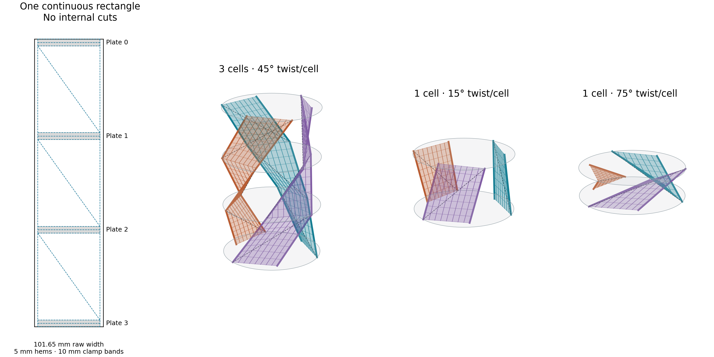

# Continuous rectangular woven straps

> This woven-shear proposal is unsuitable for the user’s fabric. See the
> [new no-shear geometry prototype](../no_shear/README.md) using articulated
> attachments and three continuous cut strips.

**Three uncut rectangular straps can provide the requested mechanism, provided
their weave can shear.** Each cell uses one flexible diagonal fold; its two
long edges carry tension. The fabric between them has an exact deformation
that preserves both warp and weft yarn lengths. The yarn crossing angle changes.
This corrects the earlier assumption that the entire cloth must behave like
an inextensible paper sheet.

The geometric path, continuous clamp connections, panel separation and local
stability models have been verified. A particular fabric roll has not been
physically tested. Weave locking, slip and shear resistance must meet the
criteria below; dense webbing or bonded laminates are unsuitable assumptions.



## Pattern and assembly

Use three identical strips. The example uses outer radius R=100 mm, inner
radius r=80 mm, six tensile edges, and twelve cells. Scale geometric dimensions
proportionally for other sizes; stiffness and load criteria must be checked
separately. Dimensions below are nominal zero-thickness geometry; use a
fabrication coupon to set fold allowances, clamp clearance and loaded free length.

| Dimension | Value |
| --- | ---: |
| Active width W between long edge fold lines | 91.651514 mm |
| Active length L per cell | 128.062485 mm |
| Hem allowance, each long side | 5 mm |
| Material allocated to each plate clamp band | 10 mm |
| Raw strip width including hems | 101.651514 mm |
| Raw length for 3 cells, including 4 clamp bands | 424.187454 mm |
| Raw length for 12 cells, including 13 clamp bands | 1666.749817 mm |

1. Cut three rectangles with their long direction along the warp and width
   along the weft. Do not cut on the bias.
2. Fold each 5 mm long-edge allowance inward once. A longitudinal stitch can
   hold the two layers together. Keep the body free to shear; do not bond it
   to a stiff backing. The edge hem's effective axial rigidity is a measured
   property, not guaranteed by these dimensions.
3. Mark the gray 10 mm bands. Between bands, mark one diagonal in the same
   direction in every cell, as shown in the template. **Do not cut, stitch,
   tape or otherwise fix the length of the diagonals.** They must change length
   through weave shear and bend in either direction.
4. At each plate, fold its 10 mm band back on itself at the middle, making a
   5 mm deep, two-layer hairpin. Both ends of the band meet the same attachment
   seam. Capture the folded band under a full-width clamp. This gives finite
   clamped area and preserves one continuous textile piece through the chain.
   **Provide a slot or open clamp bar along the seam:** an unbroken plate disk
   blocks the fabric. The hemmed ends of each band have four layers; its center
   has two. The clamp must maintain pressure across that thickness difference.
5. Put the three clamp seams 120 degrees apart. On plate A, each seam joins
   outer radius R at angle 0 to inner radius r at angle 60 degrees, with two
   copies rotated by 120 and 240 degrees. On plate B, exchange the two radii.
   Alternate A and B along the chain. The left and right strip edges retain
   their identities through every clamp; the radius of each edge alternates.
6. Guide the initial diagonal folds by hand. Their bend can reverse during
   motion; there is no fixed mountain/valley assignment. Clamp against slip at
   every plate. Do not let the strap slide through the entire stack.

Twist each upper plate in the angular direction from its L anchor toward its
R anchor, viewed consistently from the same end of the chain. This is clockwise
on the plate template. Reversing that direction requires mirroring the pattern.

The unclamped spans are L long, measured between the two band boundaries.
The repeated material pitch is L+10 mm. The marked diagonals are guides to
an admissible cloth shape, not rigid ribs. Finite plate and fabric thickness
requires clearance and a positive packed height.

Templates in millimeters:

- [Three-cell SVG](strap_3_cells.svg) and [DXF](strap_3_cells.dxf)
- [Twelve-cell SVG](strap_12_cells.svg) and [DXF](strap_12_cells.dxf)
- [Alternating plate clamp layouts](plate_clamps.svg)

**Cut only the CUT_OUTLINE layer.** All other DXF layers are marking or fold
guides. The SVG includes a margin and labels outside the physical cut outline.
The plate drawing identifies anchor seams and folded-band footprints inside
a circular envelope; it is not a solid-disk cutting pattern or a finished
fastener or clamp-strength design.

## Exact fabric geometry

With two edge groups at radii R and r, exchanged at each plate,

```
W = sqrt(R^2+r^2-R*r)       [60 degree angular separation]
L = sqrt(R^2+r^2)
h^2 = 2Rr cos(theta).
```

For one material rectangle, name its bottom-left, bottom-right, top-left and
top-right spatial corners A, B, C and D. Split the rectangle along A-D. For
material coordinates 0<=x<=W, 0<=y<=L, define

```
F1(x,y) = A + x(B-A)/W + y(D-B)/L       when y/L <= x/W
F2(x,y) = A + x(D-C)/W + y(C-A)/L       when y/L >= x/W.
```

The maps agree exactly on x/W=y/L. Each of their two derivative columns has
unit length because the four boundary edges retain lengths W,L,W,L:

```
|F_x|=|F_y|=1,
G = [[1,c],[c,1]].
```

Thus every warp and weft segment keeps its length, including yarns that cross
and bend at the diagonal. The two triangles have the same c since their shared
diagonal obeys |D-A|^2=W^2+L^2+2WLc. The construction is a uniformly sheared
rectangle folded about one diagonal. It is a fabric/yarn isometry, not an
isometry in every in-plane direction: diagonal distances and area change.

For lower-left radius a and lower-right radius b,

```
c(theta) = [ab(cos(theta)+cos(60 deg)) - b^2
            - a^2 cos(theta+60 deg)]/(W L)
gamma(theta) = asin(c(theta)).
```

Successive cells use (a,b)=(R,r) and (r,R). With r/R=.8, maximum absolute
shear over the entire 0..90 degree stroke is **35.196988 degrees** in even
cells and **6.516908 degrees** in odd cells. The smallest yarn crossing angle
is 54.803012 degrees. The minimum fabric area ratio is 0.817175. This is yarn
rotation, not 35% tensile extension.

The even cell becomes planar and reverses the diagonal bend at 21.7868 degrees
of twist. A stitched diagonal or a fixed mountain fold would obstruct the
constructed path.

### Continuous finite clamp bands

Let a plate seam run from P to Q, with unit tangent e=(Q-P)/W and in-plane
unit normal n pointing inward. For a material band of length b_c,

```
F_band(x,u) = P + x e + min(u,b_c-u) n,
0<=x<=W, 0<=u<=b_c.
```

Both band ends meet P+x e; each yarn retains its length. The two layers overlap
intentionally under the clamp. For b_c=.1R the footprint is .05R deep, lies
inside the plate circle, and spans 63.194 degrees. The three rotated clamp
footprints are disjoint. Long-edge hems can be represented by reflecting their
material coordinates onto the adjacent cloth; matched longitudinal stitches
therefore add no incompatible length constraint to this ideal map.
Finite fold radius separates the band exits and changes this nominal footprint;
the clamp detail must allow that offset.

### Separation throughout the stroke

Each triangular facet lies within the convex hull of its three anchors, hence
inside radius R and between its two plate planes. At any intermediate height,
a strap section consists of two segments L-E-R. For r/R>3/8 and 0<=theta<90
degrees, these three points occupy an angular sector narrower than 120 degrees.
The other straps are rotations by 120 and 240 degrees, so they cannot intersect.
Different cells occupy disjoint open height intervals. The full sector bounds
are recorded in [woven_check.json](woven_check.json).

The exactly flat endpoint has intentional overlap/contact. Its ideal two-layer
facets do not shrink to zero area. Real thickness sets the final packed gap.

## Fabric and edge requirements

Use an uncoated, shear-compliant woven fabric, with long yarns aligned with the
strap length. Light open plain weaves or twills are candidate classes; the
specific roll must pass a picture-frame shear coupon. Dense webbing, resin,
adhesive laminates and diagonal reinforcement can prevent the required yarn
rotation. Knitted material needs a different constitutive model.

- The body should reach at least **40 degrees of shear in both directions**
  without locking, tearing or severe resistance, leaving margin above 35.2.
- Test a coupon with the proposed hems and clamp treatment. Tension affects
  shear resistance and locking; a loose hand-drape test alone is insufficient.
- The worked stability example assumes **EA=1000 N per strap**, divided equally
  between its two effective edges. This means each has EA=500 N: approximately
  5 N causes 1% elastic extension. Within the two-triangle model, total EA can
  include the body warp rigidity plus both hems: half the body has the axial
  strain of each long edge. Measure the whole strip's axial response rather
  than infer EA from nominal fabric thickness.
- The finite-shear calculation below uses U_s=(kappa/4)(gamma_1^2+gamma_2^2)
  per strap and kappa=G_2D W L. On an aligned cell the angles are equal, giving
  U_s=(kappa/2)gamma^2. Its tested range is kappa/(F R)<=.05. For R=.1 m, F=10 N,
  this corresponds to G_2D<=4.26 N/m in that quadratic model. A nonlinear,
  hysteretic coupon curve should be used directly instead of replacing it
  with an unjustified constant. The tested values are not a universal bound.

The distinction between paper isometry and woven yarn rotation is established
in [Oehri et al. 2024](https://doi.org/10.1145/3687928). Experimental locking
and weave dependence are covered by [Mohammed et al. 2000](https://doi.org/10.1016/S1359-835X(99)00081-0)
and [Cao et al. 2008](https://doi.org/10.1016/j.compositesa.2008.02.016).
The required shear is a real material condition, not an assumption that every
fabric can accommodate it.

## Tilt stability under load

The two edges of each of three straps reproduce the six tensile paths with
exchanged radii. Their constraint rank is five for R!=r and h>0: plate tilt
requires first-order edge extension while twist-contraction remains free.
The cloth map does not introduce an additional fixed diagonal constraint.

With 12 cells, F=10 N, r/R=.8 and EA=1000 N per strap, the fixed-natural-length
edge model predicts first tilt instability at **74.44 degrees per cell**.
Treat this as the low-shear-carrier limit, not a safe working limit.

A second model includes finite fabric shear energy for both triangles and
solves the alternating cell twists and heights at equilibrium. It includes
the full 67-coordinate plate Hessian, with translations, tilts and prestress.
Both ends are held in lateral position and orientation; the loaded end may
move axially. The following are the largest tested shear stiffness,
kappa/(FR)=.05; all smaller tested values 0, .001, .01 were also positive.

| Average twist | Equilibrium cell twists | Smallest transverse eigenvalue | Result |
| ---: | --- | ---: | --- |
|45 degrees|43.895 /46.105 degrees|.0018165|Locally stable|
|60 degrees|59.525 /60.475 degrees|.0013976|Locally stable|
|65 degrees|64.755 /65.245 degrees|.0012370|Locally stable|

Eigenvalues use translations/R, rotations in radians and energy/EA_strap R.
All full-Hessian eigenvalues are also positive. These are conditional results
for the stated material model, not physical tests or a stability guarantee
for unmeasured cloth. The model omits locking, friction, hysteresis, bending,
contact and independent interior cloth deformation or wrinkling. Passive
selection of the drawn fold shape is not proved; the geometry establishes
that the cloth can follow it.

At nonzero axial load, exact flatness is not a working state. Use a positive
stopping height; flat packing is unloaded storage with thickness clearance.

## Verification and files

[woven_check.py](woven_check.py) checks 2,001 poses for each cell parity, all
three finite-area panels, every seam of a 12-cell chain, and finite hairpin
clamp bands. Maximum yarn metric error is 1.2e-15; total yarn-length error is
9e-16, and seam error is zero. Its continuous separation argument covers
between sampled poses.

Independent triangle-intersection and coplanar-overlap checks passed 2,005
poses per parity, including the exact fold reversal and nearly flat poses.
Results are in [woven_independent.json](woven_independent.json).

[cloth_mechanics.py](cloth_mechanics.py) uses the existing PyTorch installation
for automatic derivatives of physical spring and shear energies. Equilibrium
residuals are below 2.7e-15; the zero-shear Hessian matches the independent
analytic edge model within 3.6e-15. A finite-difference energy check agrees
within 4e-11. Results are in [cloth_mechanics.json](cloth_mechanics.json).

```sh
python3.11 -m trussbuckling.research.manufacturable_panels.woven_check
python3.11 -m trussbuckling.research.manufacturable_panels.cloth_mechanics
python3.11 -m trussbuckling.research.manufacturable_panels.pattern
```

The templates are generated by [pattern.py](pattern.py). Its dimensions are
explicit constants at the top. The illustrated source is preserved alongside
the SVG/DXF outputs. No physical fabrication, strength, wear or fatigue test
has been performed.
