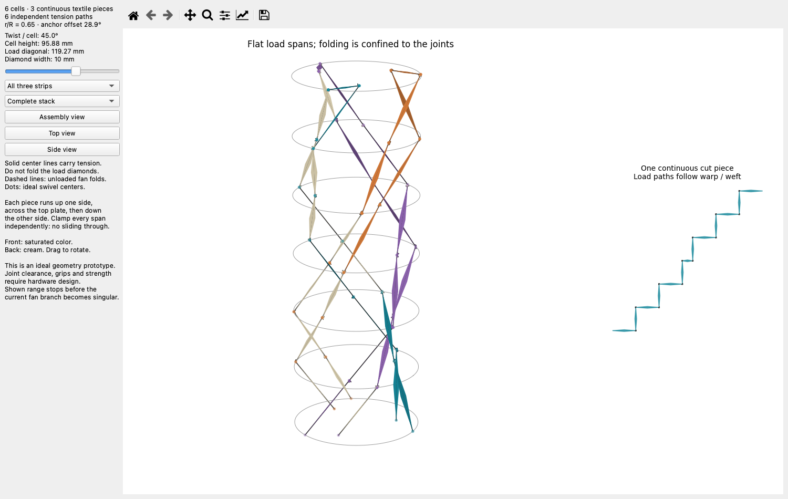
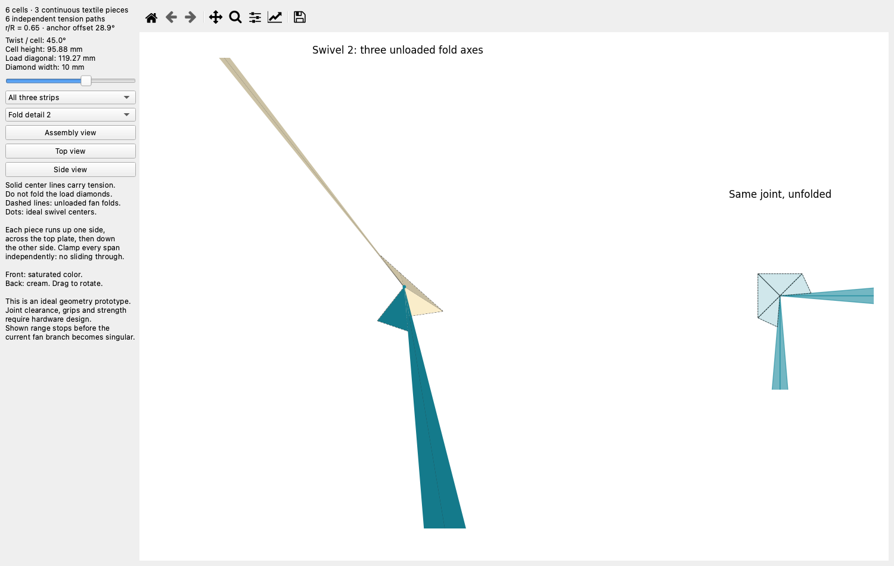

# Three continuous strips without weave shear

This replaces the wide, shearing panels with **three cut strips, each routed up
one side of the stack and back down the other**. Each strip contains two tensile
runs per cell, so the stack retains six independently clamped load paths. The
strips must not slide through the anchors as freely reeved loops.

This is a verified ideal geometry and a paper-model cutting net. The articulated
grips, their clearances and their load capacity still require mechanical design.
The blue points are ideal swivel centers, not instructions to punch grommet holes
at the sharp textile corners.



Run the independent viewer:

```sh
python3.11 -m trussbuckling.research.no_shear.gui
```

Select a **Fold detail** to inspect a joint in 3D alongside its unfolded pattern.
Saturated faces are the front; cream faces are the back. Solid center lines carry
tension. Dashed lines in the small fans are folds. The load diamonds stay flat.



## Geometry

The plate geometry remains six cells, R=100 mm, r=65 mm, and 28.9 degrees between
the two anchors in each pair. Three pairs are spaced 120 degrees apart.
Each continuous textile piece has:

- Six load diamonds going up the first anchor family.
- One short bridge held on the top plate.
- Six load diamonds returning down the second anchor family.
- Twelve small, unloaded folding fans joining those pieces.

The load diagonal is L=sqrt(R²+r²)=119.2686 mm; the top bridge diagonal is
sqrt(R²+r²−2Rr cos(28.9°))=53.3288 mm approximately. Diamond width is 10 mm and
fan radius is 4 mm in this geometric prototype. These widths are not strength
specifications. Use the generated dimensions for exact values.

Each span is a planar diamond supported along its long diagonal. Its short
corners are free, so they impose no extra plate-to-plate distance constraint.
Both opposed radius families obey

```
L² = h² + R² + r² − 2Rr cos(theta)
h² = 2Rr cos(theta).
```

Each fan comprises four triangular sectors joined by three concurrent fold axes.
The two middle sectors are 90 degrees. The end sectors are adjusted so the flat
load diagonals alternate between horizontal and vertical: cut them along warp
and weft, respectively. Measure tensile stiffness in both directions. Three serial rotations about concurrent axes let the
neighboring load facets change orientation without shearing the cloth.

For every facet, its spatial map is F(X)=QX+t, where Q is a proper rotation.
Therefore `(DF).T @ DF = I`: all in-plane lengths and angles are preserved.
The fan maps agree along every shared crease. The complete cut net is connected
and has no overlapping material regions. This is sheet isometry, not the
previous model's yarn-angle rotation.

The viewer follows a continuous folding branch over **11–65 degrees per cell**.
Its verified interval is stored in [routed_check.json](routed_check.json). The current branch has an
Euler-coordinate discontinuities near 6, 10.104 and 67.1 degrees; motion past 65 degrees is
not presented as an assembled working path. Finding another continuous branch
and checking its contact would be separate work. This version does not claim
flat packing.

## Attachments and assembly

1. Make three copies of [the nominal cut/fold net](routed_strip.svg), aligning
   horizontal/vertical load diagonals with the cloth's two yarn directions.
   Black outlines are cuts; dashed brown lines are folds.
2. Keep each long load diamond flat. Fold only the small fans, matching the
   viewer. The two extreme ends of the flat pattern both finish at the bottom
   plate; the short middle diamond bridges the two anchors on the top plate.
3. Fix the free length of each span independently at every plate. The load must
   go directly into an articulated grip, leaving the connecting fan unloaded.
4. Each arriving and departing span must be able to orient independently. A
   single rigid jaw holding both spans at a fixed included angle defeats the
   proposed motion. Full-width clamps fixed to the plate also defeat it.

The common swivel centers in the model are ideal. A standard hole placed at a
sharp fan vertex is not a finite-strength attachment. A grip must capture a
finite reinforced region of the loaded diamond and carry its force through the
specified effective pivot. Real joint bodies must clear the fan; an annular cutout around each virtual
center is one possible provision, but it is not included in this prototype. Simply moving
the incoming and outgoing pivots to opposite plate faces is not automatically
valid: the fan then needs a redesigned connector between two different centers.
Neither the SVG nor the viewer includes that hardware redesign. Offset jaws
can grip farther along each diamond while their force line passes through the
virtual pivot; measure the resulting complete span stiffness, including those
grips, before substituting a material EA into the stability model. A paper model
can verify the folds; it cannot qualify the 40 N assembly.

## Verification and tension stability

[routed.py](routed.py) checks every triangular sheet metric, fan/diamond seam,
load length, flat-net connectivity, and sampled triangle intersections of all
three strips, including coplanar overlap. The metric identity above is exact;
collision checking is sampled. Finite thickness, plate contacts and joint
hardware are excluded. Numerical checks are saved in [routed_check.json](routed_check.json).

The six fixed tensile diagonals retain the previous six-path mechanics. The
new audit removes fabric shear energy entirely. With 40 N axial tension,
R=100 mm and **EA=500 N per individual run** (1000 N per pair), the full
31-coordinate plate Hessian is positive at tested 45, 60 and 75 degrees,
including 5 mm lateral offset plus 1 degree end tilt. All runs remain taut.
The nominal model loses tilt stability near 79.95 degrees. See
[serpentine_mechanics.json](serpentine_mechanics.json).

This is conditional local stability of the tensile paths. The 75-degree
mechanics result does not extend the verified folding range. It also does not
prove grip strength, passive fold selection, wear or stability of unmodeled
cloth bending modes. Under load, ordinary axial elastic extension remains:
the stated EA gives approximately 1.64–2.55% nominal extension at 45–75 degrees.
Zero imposed geometric shear does not mean zero elastic strain under force.

```sh
python3.11 -m trussbuckling.research.no_shear.fan
python3.11 -m trussbuckling.research.no_shear.routed
python3.11 -m trussbuckling.research.no_shear.serpentine_mechanics
```
