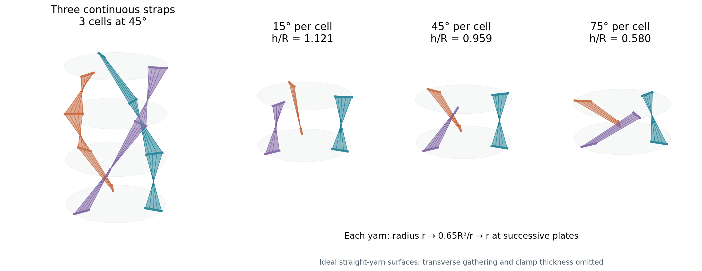
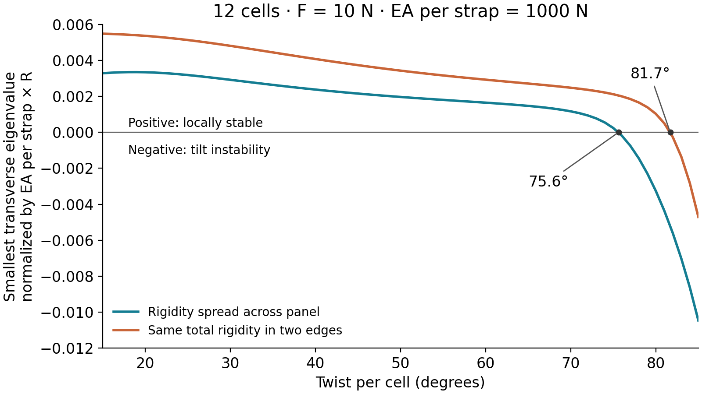

# Continuous fabric panels for a twisting chain

**Follow-up:** An explicit continuous rectangular woven-strap construction is
now derived in [the manufacturing study](../manufacturable_panels/README.md).
It preserves warp and weft lengths while allowing their crossing angle to
change. The sheet-isometry obstructions below still apply to fabric that
cannot shear; they do not rule out that woven construction.

The strongest candidate is **three continuous textile straps with radially
reversed attachments and deliberately loose transverse yarns**. An independent-yarn
model of these panels has an exact twist-contraction mechanism and
first-order resistance to plate tilt. Realizing it requires an engineered textile;
ordinary tight webbing cannot follow the calculated surface without strain.

An alternative using opposing bias directions at one radius can also resist
tilt, but locks the contraction when its yarns are inextensible. An elastic
version permits modest contraction and then loses stability in the numerical
examples below. FP-ori folding geometry alone does not remove the original
first-order tilt weakness.

Scope: rigid plates, fabric-only connections, end-twist actuation, an axial
load resisting contraction, and straps continuous through multiple cells.
The proposals below are independent of the window/ladder straps in the other
study. The preferred proposal still uses radial variation: the mathematical
restriction below explains why it remains useful.



## What the literature supports

| Approach and primary source | Relevance to this chain |
| --- | --- |
| [Liu et al. 2024, FP-ori](https://doi.org/10.1038/s41598-023-50353-4) | Exact symmetric folding with diagonal cuts. The derivation assumes parallel end facets, and the CAD setup constrains coincident axes. These do not establish free plate alignment. |
| [Pena, Llorens and Sastre 2010, textile tensegrity](https://doi.org/10.1260/0266-3511.25.1.57) | Replaces tendons with continuous membrane strips and panels. Establishes a manufacturing precedent, not the required folding path. |
| [Gupta et al. 2020, knit tensegrity shells](https://doi.org/10.1007/s42452-020-2693-4) | CNC-knit membranes replace cables; pockets and localized reinforcement integrate connections into the textile. Supports tailored textile manufacture. |
| [Melnyk 2023, knitted tensegrity tower](https://www.arcc-journal.org/index.php/arccjournal/article/download/1155/927/3588) | Six membrane panels assembled from 54 knitted pieces form a helix tower. Flexibility is intentional; it does not establish tilt-stable flat stacking. |
| [Melnyk 2024, deployable knitted hyperboloid](https://doi.org/10.1007/978-981-99-8405-3_36) | Demonstrates a knitted membrane accompanying deployment, but rigid rods determine its motion and its radius changes. |
| [Yang and Sultan 2016](https://doi.org/10.1016/j.ijsolstr.2015.09.012) | Energy and finite-element treatment of multistage tensegrity-membrane systems. Relevant to the next continuum analysis. |
| [Harrison et al. 2012](https://doi.org/10.1016/j.compositesa.2012.01.024) | Experiments establish coupling between yarn tension, shear stiffness and wrinkling. A textile's shear stiffness cannot simply be assumed constant. |
| [Hosseini et al. 2017](https://pmc.ncbi.nlm.nih.gov/articles/PMC5666990/) | Yarn rotation, locking and wrinkling distinguish textile deformation from rigid origami. |
| [Cianciarulo et al. 2025, braided muscles](https://pmc.ncbi.nlm.nih.gov/articles/PMC11940222/) | Opposite braid directions demand incompatible axial changes under ideal twist. Their experiments also show that elasticity can dominate rather than the ideal predicted slackening. |
| [Chopin and Kudrolli 2013, twisted ribbons](https://doi.org/10.1103/PhysRevLett.111.174302) | Tensioned ribbons develop wrinkles, facets and loops. Width alone does not ensure a stable panel. |
| [Pham Dinh et al. 2016](https://arxiv.org/abs/1605.03728) | Faceted twisted ribbons approach isometry in particular small-thickness/small-load limits. This is not a guaranteed finite-load folding mechanism. |
| [Filipov, Tachi and Paulino 2015, zipper tubes](https://doi.org/10.1073/pnas.1509465112) | Strong suppression of bending while retaining deployment. The panels carry compression as well as tension, so bare fabric does not inherit this result. |
| [Ando et al. 2020, composite origami strips](https://doi.org/10.1007/s42452-020-03846-0) | Long strips with compliant hinges simplify manufacture, but use rigid facets; excluded by fabric-only sides. |
| [Jeong et al. 2025, knitted origami](https://arxiv.org/abs/2511.01272) | Adds fusible yarn to stiffen facets and suppress unintended buckling. Also excluded here. |

The sources support textiles replacing cables and specialized textile
deformation. They do not provide a demonstrated, off-the-shelf solution with
all the requested properties. The equations and numerical comparisons below
are independent calculations, not reported performance from these papers.

## Why equal-radius panels do not automatically fix tilt

Consider a straight, taut yarn between fixed material anchors on two parallel
plates. Write the planar anchors as complex numbers p(s), q(s), with s indexing
yarns across a panel. At relative twist theta and height h,

```
L(s)^2 = h^2 + |p(s)|^2 + |q(s)|^2
         - 2 Re[exp(i theta) q(s) conjugate(p(s))].
```

For every yarn to retain its length over an open interval of theta, subtract
the equations for two yarns. Independence of 1, cos(theta) and sin(theta)
requires

```
q(s) conjugate(p(s)) = a common complex constant,
L(s)^2 - |p(s)|^2 - |q(s)|^2 = a common real constant.
```

If all anchors are at one radius, every yarn has the same angular offset.
They are rotated copies of the original link and retain its first-order
tilt/translation weakness. To obtain independent geometric constraints while
keeping these assumptions, vary the radial ratio. This is a classification of
straight, inextensible yarn mechanisms with fixed anchors and coaxial motion;
it does not rule out elastic fabrics, sliding/contact mechanisms, or other
moving boundaries.

There is a separate sheet-compatibility obstruction. Let a ruled panel join
anchor curves A(s) and B(s) on planes separated by h. Its straight yarn surface
is X=(1-t)A+tB. Developability requires

```
det(A', B-A, B') = 0.
```

For parallel end planes at h>0 this requires corresponding anchor-curve tangents
to be parallel. Generic relative twist violates this. A smooth, intrinsically
flat inextensible sheet therefore cannot be treated as a continuum of those
straight yarns. Some allowance for shear, stretch, crimp or transverse slack
is required; the proposal below uses loose transverse loops.

## Proposal A Three continuous radial panels

Use three radial clamp seams per plate, spaced 120 degrees apart. A strap
occupies the radial interval a <= r <= b, where b=R and C=ab. Connect each
lengthwise yarn to radius q=C/r on the next plate, and back to r on the next:

```
plate 0       plate 1       plate 2       plate 3
   r     ->     C/r    ->      r     ->     C/r
```

Each entire strap continues through the chain. Every intermediate plate grips
its complete registration seam against slip. This is three textile pieces,
with three line clamps per plate, rather than individually terminated cords.
The radial order across the strap reverses in each cell. Adjacent cells have
the same twist handedness, so end rotation accumulates normally.

Choose the unloaded active length of each yarn as

```
L0(r)^2 = r^2 + C^2/r^2.
```

Every yarn then has the same exact inextensible motion:

```
h^2 = 2 C cos(theta),       0 < theta < 90 degrees.
```

At positive height and twist, a panel cannot intersect itself: equal height
fixes t, and the two independent planar directions at its ends fix r.
Each panel occupies an angular sector narrower than 90 degrees, so three
panels 120 degrees apart are disjoint. Convexity of the radius-R disk bounds
their entire surfaces by R. Different cells occupy separate height intervals.
At theta=0 the reversed yarns can intersect in one plane; start partly twisted.
At h=0, intentional overlap, finite thickness and packing require separate
treatment.

For R=100 mm and a=65 mm:

| Quantity | Value |
| --- | ---: |
| Radial clamp span | 35.00 mm |
| Ideal untwisted height | 114.02 mm |
| Shortest active yarn, r=sqrt(C) | 114.02 mm |
| Longest active yarn, at either edge | 119.27 mm |
| Variation in active yarn length across width | 4.61% |
| Ideal height at 45 degrees | 95.88 mm |
| Ideal height at 75 degrees | 58.01 mm |

The textile needs strong lengthwise yarns with these tailored active lengths,
and loose, looped or sufficiently compliant transverse connections. Curved
registration seams and a tailored warp knit are candidate manufacturing
methods. A rectangular length of ordinary webbing is not a verified cutting
pattern for this design. Reinforcing the edges while keeping a lighter
interior improves stiffness per unit of load-bearing yarn material, but
approaches the two-edge load path already considered in the other study.

### Transverse allowance

The required transverse tangent has magnitude

```
g(r,t,theta) = |(1-t)e0 - t(C/r^2)e_theta|.
```

The bound g <= max(1,C/r^2) holds throughout the motion. Thus a sufficient
contour-length allocation for individual transverse yarn segments is

```
B = integral_a^b max(1,C/r^2) dr = 2(b-sqrt(ab)).
```

For the example, B=38.755 mm, 10.73% longer than the 35 mm seam span. This
allowance must be distributed across width, not merely added at one edge.
The panel gathers much more strongly between plates: its midpoint transverse
path at 45 degrees is only 13.969 mm. Slack loops must accommodate that change.
These are yarn contour-length bounds, not a complete collision-free knit or
sewn-sheet construction. Yarn junction friction, shear locking and gathering
remain the principal unverified manufacturing questions.

### First-order tilt stiffness

Let E(r)dr be the axial rigidity EA of yarns in width dr. Define

```
w = E(r)/L0(r)^3
A = integral w r^2 dr
B = integral w (C/r)^2 dr
P = integral w C dr.
```

After allowing lateral translation to relax, the ideal geometry has material
tilt stiffness per axis

```
K_tilt = (3/2) h^2 (A B - P^2)/(A+B-2P cos(theta)).
```

This is the extension contribution when all yarns are engaged, evaluated on
the ideal geometry. Positive pretension makes small perturbations remain taut.
An unloaded tension-only textile can slacken and does not have the same
bilateral linear stiffness.

Cauchy-Schwarz gives AB>P^2 whenever the load-bearing yarns have a genuine
radial spread. The plate-length Jacobian has rank five: the intended
twist-contraction remains, while lateral translation and tilt require
first-order yarn extension. Direct Jacobian/Schur-complement checks agree with
the formula to 7e-16 in normalized units.

For uniform axial rigidity across the radial coordinate, at 45 degrees,
K_tilt=0.05417 EA_strap R. Concentrating the same total axial rigidity into
the two strap edges gives about 2.49 times this material stiffness. This
comparison excludes prestress and is distinct from the full-stack result.

### Fixed-length elastic stack

To model one physical textile throughout the motion, keep L0(r) fixed. The
actual length and tensile force density are

```
ell(r)^2 = L0(r)^2 + h^2 - 2C cos(theta)
T(r) = E(r) [ell(r)/L0(r)-1]
F = 3h integral T(r)/ell(r) dr
M = F C sin(theta)/h.
```

The positive root of force balance gives the loaded height. All yarns are in
tension. The assembled Hessian includes both extension stiffness and geometric
stiffness from existing tension, with independent translations and rotations
of every interior plate. Both ends have fixed centers and orientation except
the loaded end's axial translation. A 12-cell chain has 67 free coordinates.

Illustrative parameters: R=100 mm, a=65 mm, F=10 N, EA=1000 N per strap,
uniform rigidity across r. These values are assumptions, not measured fabric
properties. Eigenvalues below use translations/R, rotations in radians, and
energy divided by EA_strap R.

| Twist per cell | Loaded height mm | Maximum yarn strain | Smallest transverse eigenvalue | Local result |
| ---: | ---: | ---: | ---: | --- |
| 15 degrees | 112.47 | 0.355% | 0.003291 | Stable |
| 45 degrees | 96.44 | 0.414% | 0.002159 | Stable |
| 60 degrees | 81.41 | 0.491% | 0.001653 | Stable |
| 75 degrees | 59.50 | 0.672% | 0.000244 | Close to instability |
| 85 degrees | 37.58 | 1.069% | -0.010463 | Unstable |

The calculated transverse onset is **75.612 degrees per cell**. The same
total rigidity concentrated at the two edges moves it to **81.694 degrees**.
Neither case remains stable arbitrarily close to flatness. These results
establish local stability of the independent-yarn surrogate, not stability
of a manufactured textile with friction, slip and contact.



At 90 degrees, the loaded equilibrium still has h=21.98 mm and is unstable.
Exact flatness is an unloaded, zero-thickness geometric limit. At fixed finite
F, the ideal inextensible relation M=FC sin(theta)/h is singular as h approaches
zero. A loaded working stroke therefore needs a positive stopping height.

## Proposal B Continuous opposing-bias sleeve

A continuous sleeve with two yarn directions at the same radius avoids the
radial inversion. Let their angular steps be theta+beta and theta-beta:

```
ell_plus^2  = h^2 + 2R^2[1-cos(theta+beta)]
ell_minus^2 = h^2 + 2R^2[1-cos(theta-beta)]
ell_plus^2-ell_minus^2 = 4R^2 sin(theta) sin(beta).
```

Two fixed lengths therefore fix theta when beta is nonzero. The all-taut
constraint Jacobian generically has rank six, so this geometry resists tilt
by also resisting the desired folding motion. Cloth shear cannot change this
endpoint-distance fact for straight taut yarns. One family must stretch,
slacken, or change its anchor/contact path.

For an elastic sleeve, use fixed natural length l0 and tension-only springs
T=k max(ell-l0,0). Solve F=m h(T_plus/ell_plus+T_minus/ell_minus), with m=3 per
family. A 162-case screen varied beta=10,20,30 degrees, kR/F from 0.3 to 100,
and l0/R from 0.5 to 3. It checked each connected branch from zero twist in
one-degree increments, stopping at the first slack family or unstable
67-coordinate Hessian. The model omits textile intersections and weave
constraints, so it is an optimistic screening model.

| Maximum allowed yarn strain along branch | Best sampled contraction | Initial height/R | Last stable sampled twist |
| ---: | ---: | ---: | ---: |
| 5% | 8.33% | 3.051 | 77 degrees |
| 10% | 8.93% | 2.076 | 53 degrees |
| 20% | 14.03% | 1.070 | 35 degrees |

These are sampled cases, not optimum bounds. All three lose transverse
stability at the next degree while both families remain taut. The low-strain
case needs tall cells and gives little contraction. This is a credible
compliant textile actuator direction, but a poor match for compact flat
stacking in the screened geometry.

## Why the other candidates were rejected

**Plain FP-ori fabric strips.** Fix the lower plate, free the upper plate and
every slit tip, and enforce all triangle-edge lengths. Eliminating the tips
leaves only the original corner-link constraints. At a coaxial pose their
rank is three. Even perfectly rigid FP facets add no first-order material
resistance to the coupled tilt/translation motions. The three, four and six
side versions have respectively 24, 30 and 42 variables and ranks 21, 27 and
39. The six-sided model can obstruct finite tilt at second order; this does
not supply first-order elastic tilt stiffness. Under symmetric axial load,
the edge-equivalent model carries force only in the corner links; all slit-tip
edges have zero force. This is not a continuum membrane stress solution.

**Rigid zipper/Miura or Sarrus strips.** These can provide additional constraints,
but require rigid or compression-bearing facets. The simple Sarrus alternative
also deploys axially without the requested twist actuation.

**Alternating handedness alone.** Matched opposite-handed cells cancel end
rotation, removing the desired summed end-twist actuation. Without a separate
synchronizing mechanism, cloth continuity does not enforce equal fold angles.

**Straps bypassing alternate plates.** For equal-radius cells with original
link length L, a straight two-cell bypass has

```
D2^2 = 4L^2 - 4R^2[1-cos(theta)]^2.
```

It is not constant during folding. A taut inextensible bypass locks the path;
slack bypasses do not provide continuous small-motion stiffness. Free sliding
through intermediate plates fixes total length rather than each segment and
does not recover the lost local constraints.

## Prototype decision and verification

The radial panel is worth a textile feasibility coupon before a full stack:
one strap between two radial clamps, with the required length profile and
transverse slack, followed by three straps and then a multi-cell assembly.
The decisive measurements are active yarn length retention, transverse
gathering without locking, clamp slip, and tilt stiffness under axial load.
A measured EA and textile constitutive law must replace the illustrative
numbers before selecting a working angle limit.

The verified result is the yarn surrogate and its elastic stack model, not a
constructed textile. A manufacturable ordinary-cloth cutting pattern satisfying all
these constraints has not yet been established.

Reproduce from the repository root:

```sh
python3.11 -m trussbuckling.research.panel_study.fp_check
python3.11 -m trussbuckling.research.panel_study.reciprocal
python3.11 -m trussbuckling.research.panel_study.bias_sleeve
python3.11 -m trussbuckling.research.panel_study.figures
```

The FP audit checks 15 configurations with maximum derivative error 1.94e-10.
The radial-panel spring-energy Hessian agrees with independent directional
second differences to 3.8e-8 relative error; 8, 16, 24 and 40 integration
points agree on the representative stack eigenvalue to 1e-14. The bias-sleeve
Hessian check has error 1.6e-8. Force residuals are below 1e-10 in normalized
units. Results are in [reciprocal_results.json](reciprocal_results.json) and
[bias_sleeve.json](bias_sleeve.json). These checks do not cover an actual weave,
fatigue, friction, finite textile thickness or nonlinear post-buckling.
